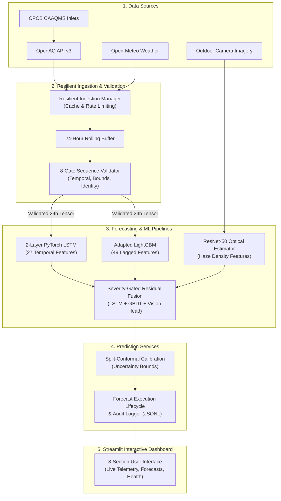

# VayuDrishti — AI-Based Air Quality Monitoring and Forecasting

[](https://vayudrishti-airquality.streamlit.app/)
[](https://www.python.org/)
[](https://opensource.org/licenses/MIT)
[](docs/qa/README.md)

> **Breathe Smarter:** An operational, multi-modal environmental intelligence platform providing real-time air quality monitoring, calibrated 24-hour sequence forecasting, and empirical uncertainty quantification across Indian urban environments.

---

## 1. Project Overview

**VayuDrishti** (*Sanskrit: "Vision of Air"*) is an end-to-end air quality monitoring and next-hour forecasting platform designed for municipal authorities, public health officials, environmental researchers, and citizens.

### The Problem It Solves
Urban centers across India experience rapid fluctuations in particulate matter ($\text{PM}_{2.5}$ and $\text{PM}_{10}$) driven by seasonal dust events, industrial emissions, and changing meteorological patterns. Many public dashboards present raw sensor values without predictive insight, or rely on complex black-box models that fail silently during telemetry dropouts.

### What VayuDrishti Does
- **Ingests Authenticated Telemetry**: Pulls continuous physical observations from official Central Pollution Control Board (CPCB) continuous ambient air quality monitoring stations (CAAQMS) via OpenAQ v3 and atmospheric reanalysis from Open-Meteo.
- **Validates Input Sequences**: Runs an 8-gate sequence validation pipeline ensuring continuous 24-hour antecedent history without lookahead bias or fabricated data.
- **Generates Multi-Model Forecasts**: Predicts next-hour ($t+1$) particulate concentrations using a 2-layer temporal LSTM and a 49-feature adapted Gradient Boosted Decision Tree (LightGBM).
- **Quantifies Predictive Uncertainty**: Computes distribution-free split-conformal prediction intervals, providing statistically guaranteed coverage bounds.
- **Resilient Fallback Handling**: Operates under strict graceful degradation. If camera imagery or external APIs drop, models automatically switch to sensor-only mode with explicit provenance badges.

---

## 2. Live Application Demo

Experience the interactive Streamlit dashboard live in your browser:

👉 **[Launch VayuDrishti Web Application](https://vayudrishti-airquality.streamlit.app/)**

*Hosted on Streamlit Community Cloud. Connects live to official CAAQMS telemetry with automated fallback caching.*

---

## 3. Key Features

- **Real-Time Air Quality Monitoring**: Live particulate readings ($\text{PM}_{2.5}$, $\text{PM}_{10}$), criteria gases ($\text{NO}_2$, $\text{SO}_2$, $\text{CO}$, $\text{O}_3$), and meteorological conditions across major Indian stations.
- **Official CPCB NAQI Engine**: Piecewise linear Indian National Air Quality Index calculation with dominant pollutant identification and personalized health advisories.
- **Dual Forecasting Modes**:
  - **Mode A (Individual Methods)**: Side-by-side inspection of Sensor-Only LSTM ($27$ features), Environmental Meteorology, ResNet-50 Vision Estimation *(Experimental / Research Evaluation)*, and 1-hour Persistence baselines.
  - **Mode B (Unified Hybrid Ensemble)**: Severity-gated ensemble combining deep recurrent representations and tree-based gradient boosting with conservative residual visual adjustment *(Experimental)*.
  - *(Note: In accordance with our empirical research findings, camera-based optical estimation is evaluated as an experimental research modality due to diurnal illumination variance. When images are absent or unaligned, the platform automatically engages zero-weight fallback ($\alpha = 0.0$) to maintain pure sensor telemetry accuracy).*
- **Distribution-Free Uncertainty**: Conformal prediction intervals (80%, 90%, 95% confidence bands) calibrated across 118,000+ holdout instances.
- **Strict Data Provenance**: Explicit badges distinguishing `LIVE MEASURED`, `RECENT BUFFERED`, and `HISTORICAL BENCHMARK` sequences. Zero synthetic imputation for live observations.
- **Operational System Health**: Real-time upstream API latency tracking, cache age metrics, station buffer completeness, and append-only forecast audit logging.

---

## 4. System Architecture



---

## 5. Technology Stack

- **Core Backend**: Python `3.10` / `3.11`
- **Dashboard UI**: Streamlit `1.28+`, Plotly, PyDeck, Matplotlib
- **Deep Learning**: PyTorch `2.0+`, Torchvision (ResNet-50)
- **Machine Learning**: Scikit-learn, LightGBM, SciPy, Joblib
- **Data Engineering**: Pandas `2.0+`, NumPy, PyTZ
- **External Telemetry APIs**: OpenAQ REST API v3, Open-Meteo Weather Ensemble
- **Containerization**: Docker, Docker Compose
- **Quality Assurance**: PyTest, Streamlit `AppTest`

---

## 6. Installation & Quick Start

### Prerequisites
- Python `3.10` or `3.11`
- Git

### Step 1: Clone the Repository
```bash
git clone https://github.com/Rushyasree/Multimodal_airquality_prediction.git
cd Multimodal_airquality_prediction
```

### Step 2: Create & Activate Virtual Environment
```bash
# Windows (PowerShell)
python -m venv .venv
.\.venv\Scripts\Activate.ps1

# Linux / macOS (Bash)
python3 -m venv .venv
source .venv/bin/activate
```

### Step 3: Install Dependencies
```bash
python -m pip install --upgrade pip
pip install -r requirements.txt
```

### Step 4: Configure Environment Variables (Optional)
Copy the example environment configuration:
```bash
cp .env.example .env
```
*(An OpenAQ API key can be added to `.env` for higher rate limits, but the application runs out-of-the-box using public endpoints and local caches).*

### Step 5: Launch the Web Dashboard
```bash
streamlit run app.py
```
Open your browser at `http://localhost:8501`.

---

## 7. Dashboard Navigation Guide

The application features 8 dedicated operational modules:

1. **🏠 Overview**: Real-time AQI hero card, current weather, health precautions, and rapid status overview.
2. **🛡️ Live Air Quality**: Station-level telemetry inspection across CAAQMS stations with data freshness indicators.
3. **📈 Individual Forecasting Methods**: Independent examination of Sensor-Only LSTM, Sensor + Weather, ResNet-50 Vision, and 1-hour persistence baselines.
4. **⚡ Unified Hybrid Forecast**: Severity-gated multimodal prediction combining recurrent LSTM sequences with LightGBM and conservative visual adjustments.
5. **⚖️ Side-by-Side Comparison**: Comprehensive evaluation comparing all forecasting methods simultaneously for any selected station.
6. **🗺️ Interactive Station Map**: Geospatial mapping of 90 CPCB monitoring stations across India with zoom, pan, and real-time AQI pins.
7. **📊 Model Performance & Benchmarks**: Operational verification metrics, per-class confusion matrices, and continuous timeseries evaluations.
8. **ℹ️ Data Sources & System Health**: Real-time API latency tracking, cache age metrics, station buffer completeness, and recent forecast audit logs.

---

## 8. Repository Layout

```text
├── app.py                                   # Main Streamlit application entry point
├── config.yaml                              # Global project hyperparameters
├── requirements.txt                         # Pinned production dependencies
├── Dockerfile & docker-compose.yml          # Container deployment specifications
├── README.md                                # Main project documentation
│
├── src/                                     # Application source code
│   ├── components/                          # Dashboard pages and UI layouts
│   ├── data/                                # Resilient ingestion & rolling buffers
│   ├── prediction/                          # Sequence validators, loaders & normalizers
│   ├── services/                            # Forecaster services, audit logger & health
│   └── utils/                               # Metrics, reproducibility & helpers
│
├── models/                                  # Trained ML checkpoints (Protected)
│   ├── lstm_baseline/                       # 2-layer LSTM checkpoint & scalers
│   ├── adapted_gbdt/                        # Adapted LightGBM model checkpoints
│   └── image_estimator/                     # ResNet-50 vision weights
│
├── tests/                                   # Automated test suites (30 files)
│   ├── test_operational_monitoring_and_reliability.py
│   ├── test_live_data_provenance_and_validation.py
│   ├── test_dashboard_navigation.py
│   └── test_eight_sections_smoke.py
│
├── docs/                                    # Documentation & Guides
│   ├── qa/                                  # Centralized QA Knowledge Base
│   ├── archive/                             # Historical research audit archive
│   ├── ENVIRONMENT_SETUP.md                 # Detailed multi-OS installation guide
│   ├── TROUBLESHOOTING.md                   # Runtime anomaly diagnostic guide
│   └── DEPLOYMENT_AND_VERIFICATION_GUIDE.md # Production deployment guide
│
├── paper/                                   # Academic conference manuscript assets
└── presentation/                            # Project slide decks and speaker notes
```

---

## 9. Quality Assurance & Testing

VayuDrishti maintains a structured QA framework:

- [**QA Overview**](docs/qa/README.md): Testing principles, objectives, and test organization.
- [**Test Strategy**](docs/qa/TEST_STRATEGY.md): Unit, integration, validation, and e2e testing levels.
- [**Test Execution Guide**](docs/qa/TEST_EXECUTION.md): Step-by-step CLI commands and debugging steps.
- [**QA Coverage Matrix**](docs/qa/QA_COVERAGE_MATRIX.md): Component-by-component coverage inventory.
- [**Release Checklist**](docs/qa/RELEASE_CHECKLIST.md): Production deployment verification gates.
- [**Bug Reporting Guide**](docs/qa/BUG_REPORTING.md): Bug classification and issue guidelines.

### Quick Test Execution:
```bash
# Run core operational monitoring tests
pytest tests/test_operational_monitoring_and_reliability.py -v

# Run 8-section dashboard smoke test
python tests/test_eight_sections_smoke.py
```

---

## 10. Contributing

Contributions are welcome! Please follow these steps:

1. Check existing [Issues](https://github.com/Rushyasree/Multimodal_airquality_prediction/issues) before opening a new ticket.
2. Submit bug reports using our [Bug Report Template](.github/ISSUE_TEMPLATE/bug_report.md).
3. Create a feature branch: `git checkout -b feature/your-feature-name`.
4. Ensure all automated tests pass before committing.
5. Submit a pull request using our [Pull Request Template](.github/PULL_REQUEST_TEMPLATE.md).

---

## 11. Data Sources & Governance

- **Central Pollution Control Board (CPCB)**: Continuous Ambient Air Quality Monitoring Station (CAAQMS) ground data governed by the [Government of India Open Data License](https://data.gov.in/).
- **OpenAQ**: Near real-time urban telemetry connector licensed under the [Open Data Commons Open Database License (ODbL)](https://opendatacommons.org/licenses/odbl/).
- **Open-Meteo**: Surface meteorological reanalysis data licensed under [Creative Commons Attribution 4.0 International (CC BY 4.0)](https://creativecommons.org/licenses/by/4.0/).

---

## 12. License

This project is licensed under the **MIT License** — see the [LICENSE](LICENSE) file for details. Academic and operational use is welcomed with appropriate attribution.

---

## 13. Maintainers & Authors

**Project Author & Lead:**
- **Teliki Rushya Sree** ([@Rushyasree](https://github.com/Rushyasree))

**Co-Authors:**
- Machireddy Swathi
- Thanuja Varakala
- Palli Shilpa

**Faculty Supervisor:**
- Prof. Thotta Ramatulasi  
*Department of Computer Science and Engineering, India*
