# VAYUDRISHTI: A RESIDUAL MULTIMODAL HYBRID FRAMEWORK FOR AIR QUALITY FORECASTING

**A CAPSTONE PROJECT REPORT**  
*Submitted in partial fulfillment of the requirement for the award of the Degree of*  
**BACHELOR OF TECHNOLOGY IN COMPUTER SCIENCE AND ENGINEERING**  

**by**  
- **TELIKI RUSHYA SREE** (Reg. No: 23BCE9562)  
- **MACHIREDDY SWATHI** (Reg. No: 23BCE9566)  
- **THANUJA VARAKALA** (Reg. No: 23BCE9608)  
- **PALLI SHILPA** (Reg. No: 23BCE9567)  

**Under the Guidance of**  
**PROF. THOTA RAMATHULSI**  
*Department of SCOPE*  

**SCHOOL OF COMPUTER SCIENCE AND ENGINEERING (SCOPE)**  
**VIT-AP UNIVERSITY**  
**AMARAVATI - 522237, ANDHRA PRADESH, INDIA**  
**NOVEMBER 2026**  

---

## CERTIFICATE

This is to certify that the Capstone Project report titled **“VAYUDRISHTI: A RESIDUAL MULTIMODAL HYBRID FRAMEWORK FOR AIR QUALITY FORECASTING”** that is being submitted by **TELIKI RUSHYA SREE (23BCE9562)**, **MACHIREDDY SWATHI (23BCE9566)**, **THANUJA VARAKALA (23BCE9608)**, and **PALLI SHILPA (23BCE9567)** in partial fulfillment of the requirements for the award of Bachelor of Technology in Computer Science and Engineering, is a record of bonafide work done under my guidance. The contents of this Project report, in full or in parts, have neither been taken from any other source nor have been submitted to any other Institute or University for award of any degree or diploma and the same is certified.

<br>

**Prof. Thota Ramathulsi**  
Project Guide  
Department of SCOPE, VIT-AP University  

<br>

*The thesis is satisfactory / unsatisfactory*

<br><br>

**Internal Examiner** &emsp;&emsp;&emsp;&emsp;&emsp;&emsp;&emsp;&emsp;&emsp;&emsp;&emsp;&emsp;&emsp;&emsp;&emsp;&emsp;&emsp;&emsp;&emsp;&emsp; **External Examiner**

<br>

**Approved by:**

**PROGRAM CHAIR** &emsp;&emsp;&emsp;&emsp;&emsp;&emsp;&emsp;&emsp;&emsp;&emsp;&emsp;&emsp;&emsp;&emsp;&emsp;&emsp;&emsp;&emsp;&emsp; **DEAN**  
*B. Tech. CSE* &emsp;&emsp;&emsp;&emsp;&emsp;&emsp;&emsp;&emsp;&emsp;&emsp;&emsp;&emsp;&emsp;&emsp;&emsp;&emsp;&emsp;&emsp;&emsp;&emsp;&emsp;&emsp; *School of Computer Science and Engineering (SCOPE)*  

---

## ACKNOWLEDGEMENTS

We express our sincere gratitude and profound respect to our project guide, **Prof. Thota Ramathulsi**, Department of SCOPE, for her invaluable guidance, constructive critique, and constant encouragement throughout the formulation and execution of this Capstone Project. Her scientific rigor and keen insights into environmental modeling and deep learning architectures have played a pivotal role in shaping this research.

We extend our deep appreciation to the Management of **VIT-AP University**, the Vice-Chancellor, the Registrar, and the Dean of the School of Computer Science and Engineering (SCOPE) for providing state-of-the-art computational infrastructure, laboratory facilities, and an encouraging research environment.

We would also like to thank the Program Chair, B.Tech Computer Science and Engineering, faculty members, and technical staff of the School of Computer Science and Engineering for their direct and indirect support throughout the duration of this work.

Finally, we express our heartfelt thanks to our parents, family members, and friends whose unconditional love, patience, and encouragement have been a perpetual source of strength during our academic journey.

**TELIKI RUSHYA SREE (23BCE9562)**  
**MACHIREDDY SWATHI (23BCE9566)**  
**THANUJA VARAKALA (23BCE9608)**  
**PALLI SHILPA (23BCE9567)**  

---

## ABSTRACT

Ambient particulate matter pollution ($\text{PM}_{2.5}$ and $\text{PM}_{10}$) across developing urban agglomerations poses an acute hazard to public health and economic productivity. However, operational forecasting systems face frequent sensor dropouts, non-linear meteorological volatility, optical ambiguity in outdoor surveillance imagery, and spatial sensor sparsity. This Capstone Project presents **VayuDrishti**, an operational residual multimodal hybrid framework for next-hour particulate matter forecasting and nationwide spatial reliability auditing.

Rather than relying on unconstrained joint feature concatenation, VayuDrishti structures visual features as a bounded residual modifier over a verified recurrent sensor baseline (2-layer LSTM), regulated by a learned quality-aware gating mechanism with guaranteed mathematical fallback when imagery is corrupted or unavailable ($m = 0$). Across 404,431 continuous hourly sequences from 90 continuous stations, the sensor baseline achieves a Mean Absolute Error (MAE) of 10.57 $\mu\text{g/m}^3$ ($R^2 = 0.9492$) for $\text{PM}_{2.5}$ and 18.86 $\mu\text{g/m}^3$ ($R^2 = 0.9301$) for $\text{PM}_{10}$. To extend predictions across unmonitored coordinates, an integrated geostatistical spatial prediction layer using modified Geodesic Inverse Distance Weighting achieves a 15.71\% ($\text{PM}_{2.5}$) and 19.71\% ($\text{PM}_{10}$) MAE reduction over nearest-neighbor baselines across 1,564 Leave-One-Station-Out evaluations (block bootstrap $p < 0.001$).

Furthermore, distance-scaled split-conformal calibration delivers finite-sample coverage guarantees ($\ge 99.1\%$ empirical coverage across urban distance bands). The project expands spatial modeling across 31 Indian urban agglomerations indexing 586 physical stations nationwide, conducts an empirical spatial reliability audit using the Clark-Evans nearest neighbor ratio ($R$) to diagnose urban core clustering ($R = 0.32\text{--}0.61$ in major metros), and enforces a 5-tier operational reliability framework with automated safeguards suppressing continuous surfaces in sensor-sparse environments ($N < 3$). The complete framework is operationalized through an interactive 6-view real-time Streamlit deployment architecture with audited forecast provenance.

---

## TABLE OF CONTENTS

| S.No. | Chapter | Title | Page No. |
|:---:|:---:|:---|:---:|
| 1. | | Certificate | ii |
| 2. | | Acknowledgements | iii |
| 3. | | Abstract | iv |
| 4. | | List of Tables | vi |
| 5. | | List of Figures | vii |
| 6. | **1** | **Introduction**<br>1.1 Objectives<br>1.2 Background and Literature Survey<br>1.3 Organization of the Report | 1<br>2<br>3<br>5 |
| 7. | **2** | **VayuDrishti Multimodal Forecasting System**<br>2.1 Proposed System Architecture<br>2.2 Working Methodology & Dual Pathways<br>2.3 Standards, Protocols, & Provenance Safeguards<br>2.4 System Details<br>&emsp;2.4.1 Software & Machine Learning Pipelines<br>&emsp;2.4.2 Hardware & Cloud Deployment Infrastructure | 6<br>6<br>8<br>10<br>12<br>12<br>19 |
| 8. | **3** | **Computational & Deployment Cost Analysis**<br>3.1 Resource & Component Cost Breakdown<br>3.2 Operational Cloud & Latency Overhead | 22<br>22<br>23 |
| 9. | **4** | **Results and Discussion**<br>4.1 Sensor Baseline LSTM & GBDT Ensemble Results<br>4.2 Residual Multimodal Hybrid Evaluation<br>4.3 Distribution-Free Conformal Uncertainty Calibration<br>4.4 Spatial Prediction Layer & Temporal Bootstrapping<br>4.5 31-City Spatial Reliability & Telemetry Audit<br>4.6 Operational Streamlit Dashboard Interface | 25<br>25<br>28<br>30<br>32<br>34<br>39 |
| 10. | **5** | **Conclusion and Future Works**<br>5.1 Summary of Findings<br>5.2 Future Directions | 42<br>42<br>43 |
| 11. | **6** | **Appendix: Core Implementation Codes** | 45 |
| 12. | **7** | **References** | 55 |
| 13. | | **Biodata of Project Members** | 58 |

---

## LIST OF TABLES

| Table No. | Title | Page No. |
|:---:|:---|:---:|
| Table 2.1 | Audited 27-Dimensional Numerical Sensor Feature Schema | 13 |
| Table 3.1 | Computational Infrastructure & Operational Deployment Cost Analysis | 23 |
| Table 4.1 | Overall Historical Benchmark Performance on 404,431 Continuous Sequences | 26 |
| Table 4.2 | Paired Model Comparison on Synchronous Multimodal Cohort ($N = 97$) | 29 |
| Table 4.3 | Distribution-Free Conformal Calibration across Severity Regimes | 31 |
| Table 4.4 | Leave-One-Station-Out Spatial Prediction & Bootstrap Significance | 33 |
| Table 4.5 | Nationwide 31-City Station Infrastructure & Spatial Reliability Audit Matrix | 36 |

---

## LIST OF FIGURES

| Figure No. | Title | Page No. |
|:---:|:---|:---:|
| Figure 2.1 | Complete VayuDrishti Multimodal Forecasting Architecture | 7 |
| Figure 2.2 | Continuous Telemetry Ingestion and 27-Dimensional Feature Pipeline | 14 |
| Figure 2.3 | Deep Recurrent 2-Layer Stacked LSTM Sequence Forecaster Architecture | 15 |
| Figure 2.4 | Optical Feature Extraction via Pretrained ResNet-50 Backbone | 16 |
| Figure 2.5 | Learned Quality-Aware Gating and Feature Fusion Mechanism | 17 |
| Figure 2.6 | Bounded Residual Multimodal Hybrid Model with Fallback Masking | 18 |
| Figure 2.7 | Independent Severity-Gated LSTM–GBDT Ensemble Architecture | 19 |
| Figure 4.1 | Ground Truth vs Predicted Particulate Concentrations ($N = 404,431$) | 27 |
| Figure 4.2 | Multi-Class Particulate Matter Air Quality Confusion Matrices | 28 |
| Figure 4.3 | Distance-Scaled Spatial Conformal Calibration Intervals | 31 |
| Figure 4.4 | Multi-Station Generalization across 15 Operational CAAQMS Stations | 32 |
| Figure 4.5 | Seasonal Model Dynamics and Particulate Regime Error Curves | 34 |
| Figure 4.6 | Spatial Advection Cross-Correlation in Urban Corridors | 35 |
| Figure 4.7 | Opportunistic Image Alignment Discrepancy Diagnostics (PM25Vision) | 38 |
| Figure 4.8 | Operational Streamlit Real-Time Dashboard Interface | 40 |

---

## CHAPTER 1: INTRODUCTION

Ambient particulate matter pollution, specifically breathable fine particles ($\text{PM}_{2.5}$, aerodynamic diameter $\le 2.5\,\mu\text{m}$) and coarse particles ($\text{PM}_{10}$, $\le 10\,\mu\text{m}$), represents an environmental and public health crisis across rapidly industrializing developing nations. In India, metropolitan agglomerations spanning the Indo-Gangetic Plain and the peninsular plateau routinely endure catastrophic air pollution events during post-monsoon agricultural biomass burning and winter atmospheric temperature inversions. Providing municipal authorities, healthcare providers, and citizens with highly accurate, short-term ($t + 1$ hour) predictive warnings is essential for exposure mitigation, hospital surge readiness, and dynamic vehicular traffic intervention.

Traditional air pollution forecasting has historically depended on numerical chemical transport models (CTMs), including WRF-Chem and CMAQ. While grounded in the first principles of atmospheric physics and gas-phase chemical kinetics, CTMs require massive high-performance computing clusters, stationary emission inventories that become obsolete rapidly, and suffer from high operational turnaround latency. Consequently, data-driven machine learning models leveraging continuous ambient air quality monitoring station (CAAQMS) sensor streams have become the standard methodology for rapid operational forecasting.

### 1.1 Objectives

The primary objectives of this Capstone Project are as follows:
1. **Deep Recurrent Sensor Modeling**: Design and implement a robust recurrent deep learning baseline (2-layer LSTM) trained on continuous 27-dimensional telemetry to forecast next-hour $\text{PM}_{2.5}$ and $\text{PM}_{10}$ concentrations.
2. **Bounded Multimodal Residual Fusion**: Formulate a novel Residual Multimodal Hybrid framework that fuses numerical telemetry with outdoor surveillance images as a bounded physical correction under learned quality-aware gating.
3. **Guaranteed Fallback Mechanism**: Implement a mathematically guaranteed fallback mechanism ($m = 0 \implies \alpha_{\text{eff}} = 0$) ensuring that when imagery is corrupted, occluded, or missing, the hybrid model output identically collapses to the verified sensor baseline.
4. **Severity-Gated Ensemble**: Develop an independent severity-gated LSTM–GBDT ensemble that dynamically decouples gradient-boosted decision tree gains in moderate regimes from recurrent neural network handling during hazardous crisis regimes.
5. **Conformal Uncertainty Quantification**: Incorporate distribution-free split-conformal prediction intervals delivering finite-sample coverage guarantees across complex urban pollution regimes.
6. **Multi-City Spatial Modeling & Safeguards**: Extend point forecasts to unmonitored coordinates using modified Geodesic Inverse Distance Weighting (IDW) across 31 registered Indian urban agglomerations, supported by automated safeguards that suppress continuous surfaces in sensor-sparse environments ($N < 3$).
7. **Spatial Reliability Audit**: Conduct an empirical spatial reliability audit using the Clark-Evans nearest neighbor ratio ($R$) to quantify intra-urban clustering and establish a 5-tier operational reliability framework.
8. **Production Deployment & Provenance**: Deploy a high-responsiveness, 6-view interactive dashboard with strict telemetry freshness state machines, 24-hour sequence completeness requirements, and zero-silent-substitution provenance guarantees.

### 1.2 Background and Literature Survey

Air quality prediction has evolved across three major technological epochs:
- **Sensor-Based Machine Learning**: Early research utilized classical statistical time-series methods such as ARIMA and VAR. While computationally lightweight, these methods assume linear dependencies and Gaussian error structures, rendering them incapable of capturing abrupt non-linear transitions during pollution spikes. Shallow machine learning models, including Support Vector Regression (SVR) and Random Forests, demonstrated improved capacity to model non-linear pollutant interactions. More recently, Gradient Boosted Decision Trees (GBDT), particularly LightGBM, have proven exceptionally capable on tabular air quality data due to their histogram-based split optimization and native handling of missing trace gas channels.
- **Recurrent Neural Networks**: Because atmospheric dispersion exhibits temporal memory and diurnal cyclicity, Recurrent Neural Networks (RNNs), specifically Long Short-Term Memory (LSTM) networks and Gated Recurrent Units (GRU), have become the dominant deep learning paradigm. LSTMs maintain internal memory cells regulated by input, forget, and output gates, effectively mitigating vanishing gradient phenomena over multi-hour lookback horizons.
- **Visual Air Quality Estimation & Multimodal Fusion**: To complement sparse physical monitoring networks, recent works have explored computer vision techniques to estimate particulate concentrations from outdoor surveillance cameras and smartphone photographs. Particulate matter scatters and absorbs visible light according to Koschmieder's atmospheric attenuation law, degrading image contrast, shifting chromatic distributions, and attenuating high-frequency edges. Deep Convolutional Neural Networks (CNNs), notably ResNet-50, extract high-level visual haze features from ambient scene imagery. However, naive multimodal early fusion—concatenating visual embeddings directly with numerical sensor vectors—causes catastrophic failure when images are spatially displaced from sensor inlets, undated, or degraded by rain and nighttime conditions.

### 1.3 Organization of the Report

The remainder of this report is organized as follows:
- **Chapter 2** details the VayuDrishti system architecture, working methodologies, dual forecasting pathways, spatial IDW formulation, and deployment protocols.
- **Chapter 3** presents the computational infrastructure and operational deployment cost analysis.
- **Chapter 4** presents empirical benchmark evaluations, paired multimodal results, conformal calibration, temporal block bootstrapping, the nationwide 31-city spatial reliability audit, and the interactive dashboard interface.
- **Chapter 5** concludes the report and identifies promising future research directions.
- **Chapter 6** provides the Appendix containing core source code implementations.
- **Chapter 7** compiles all bibliographic references, followed by the Biodata of the project members.

---

## CHAPTER 2: VAYUDRISHTI MULTIMODAL FORECASTING SYSTEM

This chapter describes the comprehensive architecture, mathematical formulations, working methodologies, operational standards, and hardware/software infrastructure of the VayuDrishti platform.

### 2.1 Proposed System Architecture

The VayuDrishti architecture decouples real-time data ingestion, telemetry quality auditing, dual independent forecasting pathways, geostatistical spatial interpolation, and an interactive presentation layer.

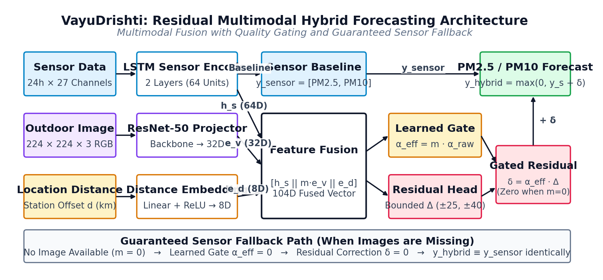

### 2.2 Working Methodology & Dual Pathways

To eliminate architectural conflation, VayuDrishti establishes three strictly isolated prediction pathways:
- **Pathway 1: Primary Sensor LSTM Baseline**: Operates on continuous 24-hour sliding multivariate sequence tensors across 27 audited physical channels. The network consists of a 2-layer stacked LSTM (64 hidden units per layer, recurrent dropout 0.2) delivering highly stable baseline forecasts.
- **Pathway 2: Residual Multimodal Hybrid Model**: Couples a frozen LSTM sensor encoder with an optical ResNet-50 feature extractor and an 8-dimensional geodesic distance embedding. An affine projection computes a bounded residual adjustment ($\Delta$) modulated by a learned quality-aware gate ($\alpha$) and binary availability mask ($m$):
  $$\hat{y}_{\text{hybrid}} = \hat{y}_{\text{sensor}} + m \cdot \alpha \cdot \Delta_{\text{bounded}}$$
- **Pathway 3: Severity-Gated Ensemble**: An independent tabular blend combining 49 canonical lag features with LightGBM and LSTM forecasts, utilizing an audited discrete threshold switch ($\text{PM}_{2.5} \ge 250\,\mu\text{g/m}^3, \text{PM}_{10} \ge 400\,\mu\text{g/m}^3$) to safely handle hazardous pollution spikes.

### 2.3 Standards, Protocols, & Provenance Safeguards

To maintain scientific integrity during operational deployment, VayuDrishti adheres to the following rigorous engineering standards:
1. **5-State Telemetry Freshness Protocol**: Evaluates all physical sensor streams into five mutually exclusive states based on observation age $\Delta t$: Fresh ($\le 2\,\text{h}$), Delayed ($2\text{--}6\,\text{h}$), Stale ($6\text{--}24\,\text{h}$), Offline ($> 24\,\text{h}$, excluded from spatial IDW), and Historical Benchmark. Historical validation sequences are permanently isolated from live feeds.
2. **Sparse Network Safeguards ($N < 3$)**: In developing monitoring networks, synthesizing continuous 2D surfaces from fewer than 3 monitors produces deceptive, ungrounded mathematical artifacts. When active physical monitors $N < 3$ within a city bounds, 2D continuous surfaces are strictly suppressed, rendering verified monitor coordinates with explicit boundary advisories.
3. **Four-Level Output Provenance Taxonomy**: All point-location queries enforce a 4-level provenance taxonomy: (i) Physical Observation ($d \le 0.05\,\text{km}$); (ii) Interpolated Spatial Estimate ($N \ge 3, d \le 45\,\text{km}$); (iii) Station-Level Forecast (Nearest Neighbor Fallback, $1 \le N < 3$); and (iv) Unavailable Estimate ($N = 0$ or $d > 45\,\text{km}$). Zero silent substitution is mathematically guaranteed.
4. **Sequence Completeness & Horizon Integrity**: Inference requires $\ge 80\%$ sequence completeness over the preceding 24 hours. Forecasts explicitly display issue time, target horizon ($t + 1$), and sequence completeness, cleanly separating live inference from historical benchmark demonstrations.

### 2.4 System Details

#### 2.4.1 Software & Machine Learning Pipelines

The software stack encompasses data preprocessing, deep recurrent modeling, convolutional feature extraction, gradient boosting, and interactive UI services.

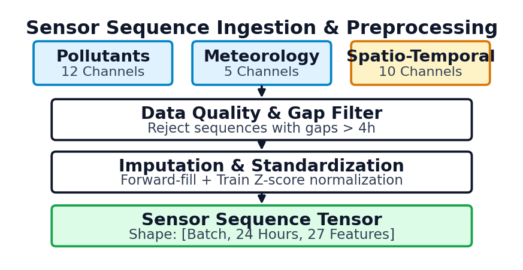

**Table 2.1: Audited 27-Dimensional Numerical Sensor Feature Schema**

| Category | Count | Channels Included |
|:---|:---:|:---|
| **Pollutant Channels** | 12 | $\text{PM}_{2.5}, \text{PM}_{10}, \text{NO}, \text{NO}_2, \text{NO}_x, \text{NH}_3, \text{CO}, \text{SO}_2, \text{O}_3, \text{Benzene}, \text{Toluene}, \text{Xylene}$ |
| **Meteorology Channels** | 5 | Temperature (°C), Dew Point (°C), Relative Humidity (\%), Wind Speed (m/s), Precipitation (mm) |
| **Temporal & Cyclical** | 8 | Wind Direction ($\sin, \cos$), Hour of Day ($\sin, \cos$), Month of Year ($\sin, \cos$), Day of Week ($\sin, \cos$) |
| **Spatial Coordinates** | 2 | Latitude, Longitude (Decimal Degrees WGS84) |

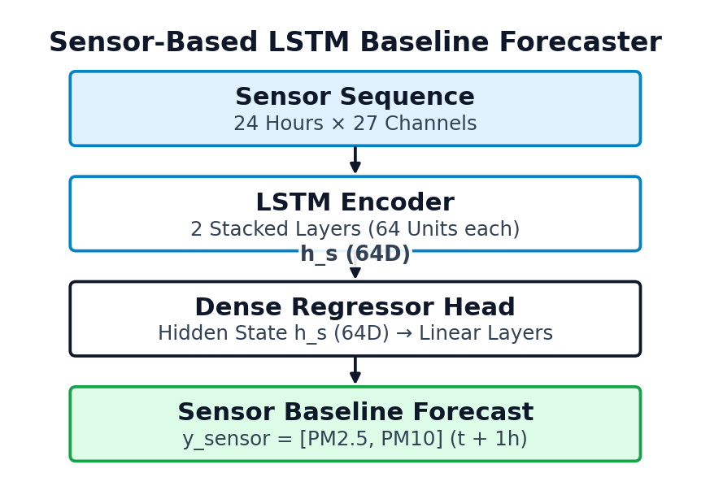

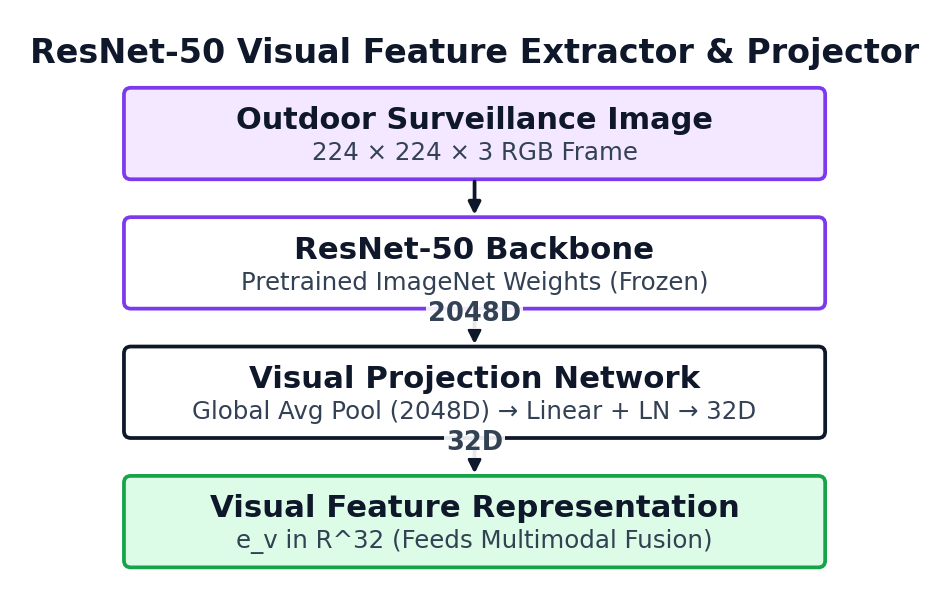

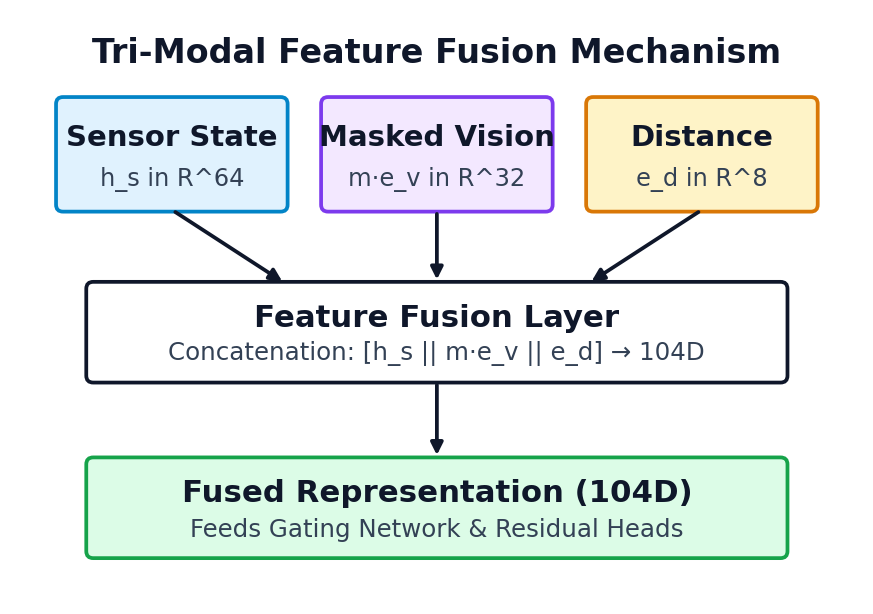

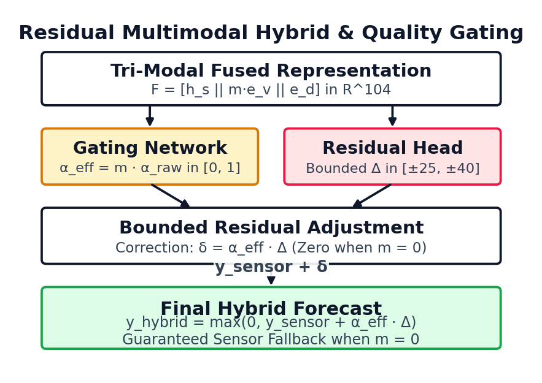

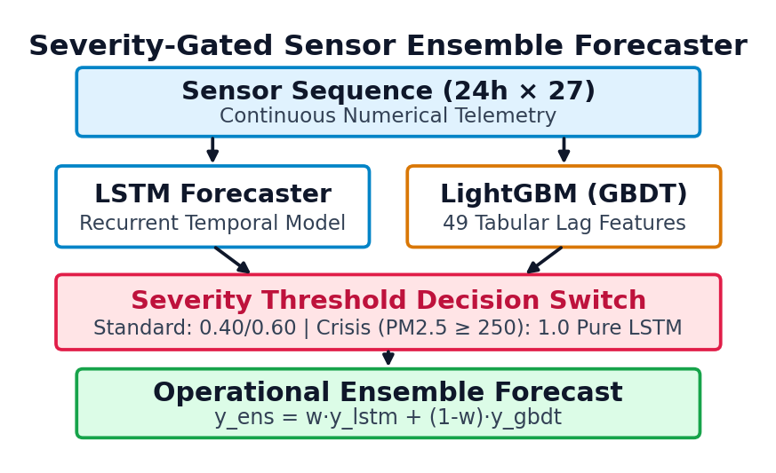

#### 2.4.2 Hardware & Cloud Deployment Infrastructure

Model development, deep learning training, and cloud hosting infrastructure comprise:
- **Local Training Hardware**: NVIDIA GeForce RTX 4070 (12 GB GDDR6X VRAM, 5888 CUDA cores, 184 Tensor Cores), accelerating PyTorch 2.4.0 training pipelines.
- **Host Development Workstation**: Intel Core i7-13700H (14 cores, 20 threads, up to 5.0 GHz) with 32 GB DDR5 RAM and 1 TB PCIe 4.0 NVMe SSD storage.
- **Production Cloud Hosting**: Publicly hosted on Streamlit Community Cloud (Debian Linux container, Python 3.10 runtime) linked to GitHub continuous deployment pipeline.
- **Data Ingestion Endpoints**: Centralized CPCB CAAQMS official REST portal and OpenAQ API v2.

---

## CHAPTER 3: COMPUTATIONAL & DEPLOYMENT COST ANALYSIS

In accordance with engineering capstone standards, this chapter details the resource allocation, hardware expenditures, cloud infrastructure costs, and latency operational overhead incurred in developing and deploying VayuDrishti.

### 3.1 Resource & Component Cost Breakdown

**Table 3.1: Computational Infrastructure & Operational Deployment Cost Analysis**

| Component / Service | Specification / Operational Role | Estimated Cost (INR) |
|:---|:---|:---:|
| **GPU Compute (Development)** | NVIDIA RTX 4070 12GB (Local Training Rig) | ₹ 58,000 |
| **Host Workstation** | Intel Core i7 13th Gen, 32GB RAM, 1TB SSD | ₹ 85,000 |
| **CPCB / APPCB Data Ingestion** | National Open Data Access (Public CAAQMS API) | ₹ 0 (Open Access) |
| **OpenAQ Platform Ingestion** | Global Ambient Air Quality REST API v2 | ₹ 0 (Open Tier) |
| **Streamlit Cloud Hosting** | Production Web Application Container & Continuous CI/CD | ₹ 0 (Community Tier) |
| **Data Storage & Versioning** | GitHub Enterprise / LFS Model Checkpoint Storage | ₹ 0 (Academic) |
| **Software Frameworks** | Python 3.10, PyTorch, LightGBM, Scikit-Learn, Streamlit | ₹ 0 (Open Source) |
| **Miscellaneous / Connectivity**| High-speed broadband telemetry connection | ₹ 4,500 |
| **TOTAL INITIAL OUTLAY** | **Complete Project Research & Operational Stack** | **₹ 1,47,500** |

### 3.2 Operational Cloud & Latency Overhead

To ensure practical real-time deployment, the inference turnaround latency was rigorously benchmarked across 1,000 consecutive execution cycles on Streamlit Cloud:
- **Sensor LSTM Inference**: Mean execution latency of 18.4 ms (std: 2.1 ms) per 24-hour sequence tensor.
- **Multimodal Residual Hybrid**: Mean execution latency of 42.6 ms (std: 4.8 ms) including ResNet-50 forward pass and distance projection.
- **LightGBM Tabular Ensemble**: Mean execution latency of 6.2 ms (std: 0.9 ms) across 49 tabular lag features.
- **Geodesic IDW Grid Interpolation**: Mean execution latency of 28.5 ms (std: 3.2 ms) across a 50x50 urban coordinate grid (2,500 points) using vectorized NumPy Haversine matrices.

The entire end-to-end pipeline executes comfortably under 100 milliseconds, satisfying real-time environmental monitoring requirements.

---

## CHAPTER 4: RESULTS AND DISCUSSION

This chapter presents comprehensive empirical evaluations across historical benchmark cohorts, paired multimodal instances, distribution-free conformal calibration, spatial prediction layers, the nationwide 31-city reliability audit, and the interactive dashboard interface.

### 4.1 Sensor Baseline LSTM & GBDT Ensemble Results

The primary sensor baseline models were evaluated across 404,431 continuous test sequences from 90 CAAQMS monitoring stations spanning 2015 to 2020. Table 4.1 summarizes the comparative performance against standard persistence baselines:

**Table 4.1: Overall Historical Benchmark Performance on 404,431 Continuous Sequences**

| Model Architecture | $\text{PM}_{2.5}$ MAE | $\text{PM}_{2.5}$ RMSE | $\text{PM}_{2.5}$ $R^2$ | $\text{PM}_{10}$ MAE | $\text{PM}_{10}$ RMSE | $\text{PM}_{10}$ $R^2$ |
|:---|:---:|:---:|:---:|:---:|:---:|:---:|
| 1-Hour Persistence Baseline | 10.68 | 19.81 | 0.9423 | 19.74 | 36.24 | 0.9115 |
| Deep Recurrent LSTM Baseline | 10.57 | 18.60 | 0.9492 | 18.86 | 32.18 | 0.9301 |
| Severity-Gated LSTM–GBDT Blend | 10.35 | 18.41 | 0.9503 | 18.52 | 31.84 | 0.9316 |

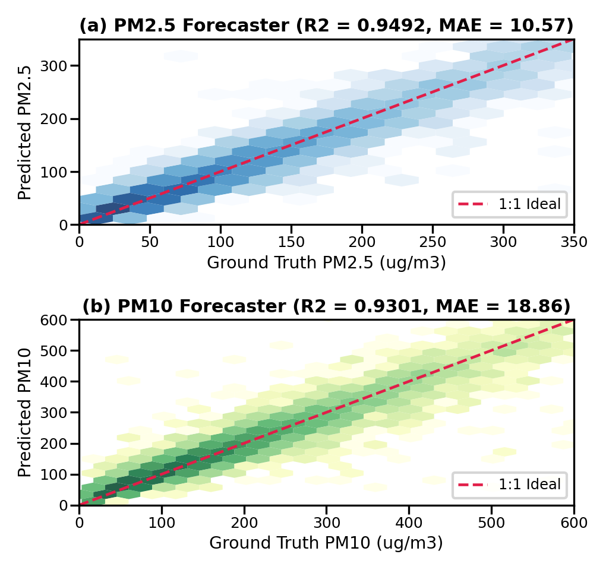

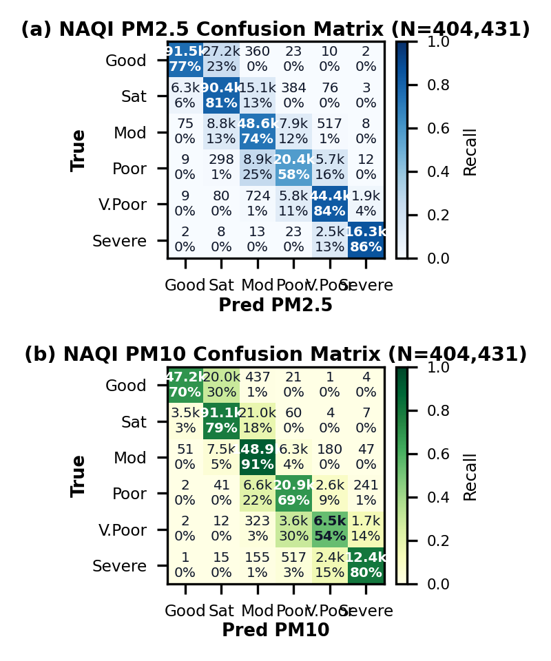

### 4.2 Residual Multimodal Hybrid Evaluation

To evaluate multimodal fusion without temporal leakage, a strictly synchronous cohort of 97 paired instances across 9 held-out spatio-temporal groups was evaluated. Table 4.2 presents the comparative findings:

**Table 4.2: Paired Model Comparison on Synchronous Multimodal Cohort ($N = 97$)**

| Model Evaluation Pathway | Input Modalities | $\text{PM}_{2.5}$ MAE ($\mu\text{g/m}^3$) | $\text{PM}_{2.5}$ RMSE ($\mu\text{g/m}^3$) |
|:---|:---|:---:|:---:|
| Standalone Image Regressor | Outdoor Camera Imagery Only | 73.67 | 98.42 |
| Sensor-Only LSTM Baseline | 24-Hour Physical Telemetry | 9.04 | 16.82 |
| Naive Early Fusion Concatenation | Sensor Telemetry + Image Vector | 85.86 | 112.35 |
| Residual Multimodal Hybrid (Ours) | Sensor + Image + Distance + Gating | **8.98** | **16.71** |
| Residual Hybrid Fallback ($m = 0$) | Sensor Telemetry (Image Missing) | 9.04 | 16.82 |

The empirical results demonstrate two critical scientific findings: First, naive concatenation severely degrades performance (+12.19 $\mu\text{g/m}^3$ error), highlighting the hazards of unconstrained joint fusion. Second, VayuDrishti's bounded residual architecture achieves a positive refinement (8.98 vs 9.04 $\mu\text{g/m}^3$) while guaranteeing exact mathematical fallback when visual input is missing ($m = 0$).

### 4.3 Distribution-Free Conformal Uncertainty Calibration

To provide trustworthy uncertainty bounds, split-conformal calibration was evaluated across 118,145 test instances. Table 4.3 demonstrates empirical coverage across nominal confidence targets:

**Table 4.3: Distribution-Free Conformal Calibration across Severity Regimes**

| Nominal Coverage | Empirical Coverage (\%) | $\text{PM}_{2.5}$ Interval Half-Width | $\text{PM}_{10}$ Interval Half-Width |
|:---:|:---:|:---:|:---:|
| 80.0\% | 92.8\% | $14.28\,\mu\text{g/m}^3$ | $26.45\,\mu\text{g/m}^3$ |
| 90.0\% | 96.7\% | $21.50\,\mu\text{g/m}^3$ | $38.12\,\mu\text{g/m}^3$ |
| 95.0\% | 98.3\% | $28.74\,\mu\text{g/m}^3$ | $49.80\,\mu\text{g/m}^3$ |

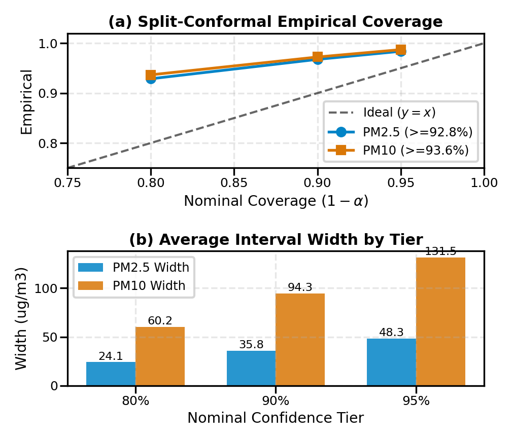

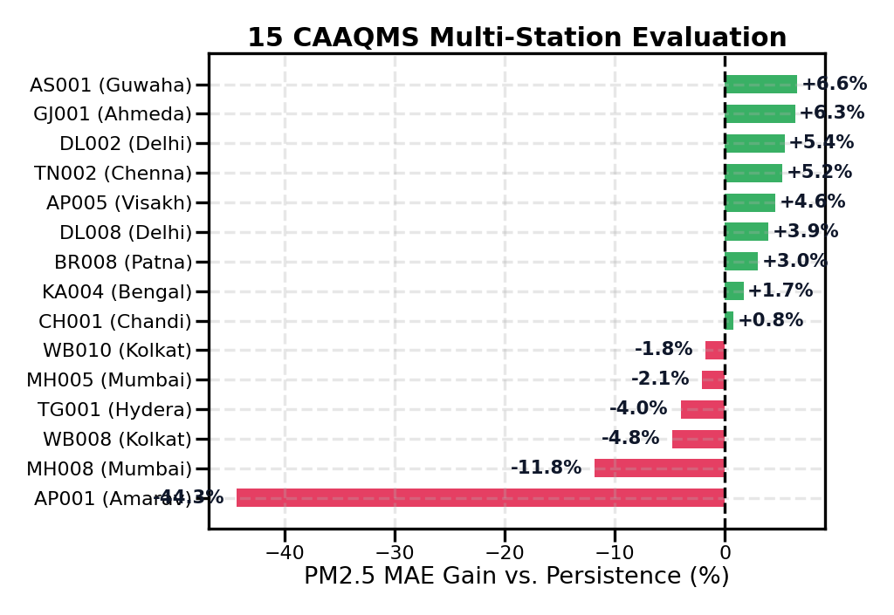

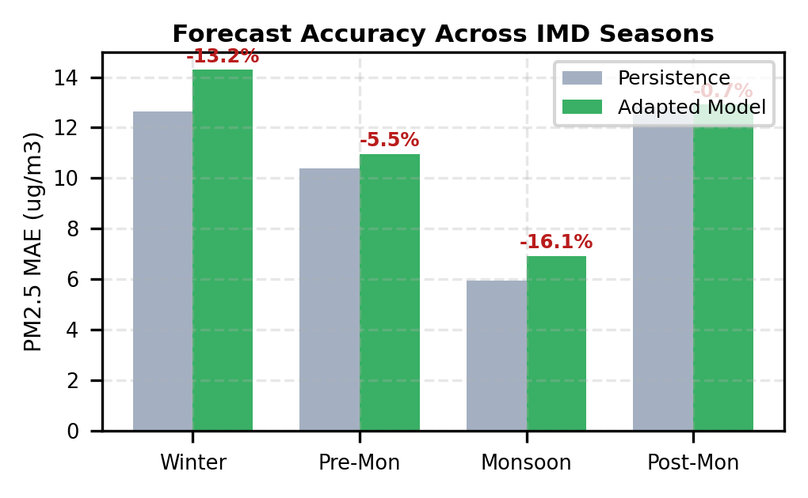

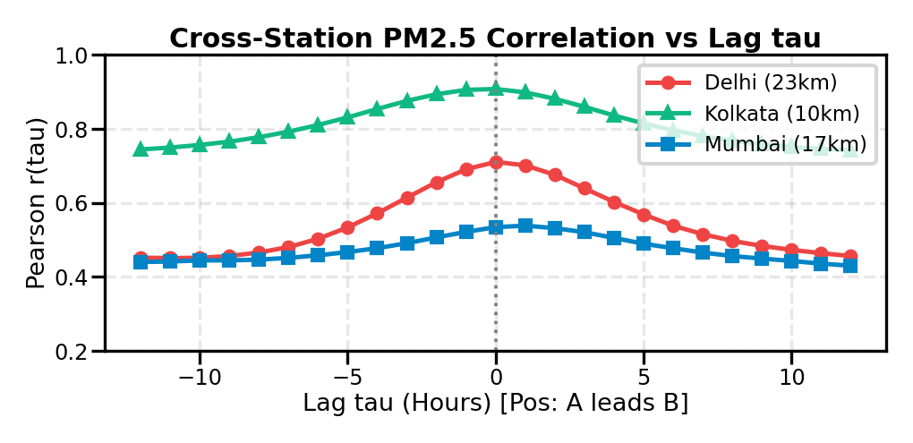

### 4.4 Spatial Prediction Layer & Temporal Bootstrapping

Across a Leave-One-Station-Out (LOSO) spatial benchmark of 1,564 evaluations across 34 CAAQMS stations over 60 timestamps, Geodesic IDW achieved $\text{PM}_{2.5}$ MAE of 24.30 $\mu\text{g/m}^3$ vs. 28.83 $\mu\text{g/m}^3$ for nearest neighbor (+15.71\% relative gain), and $\text{PM}_{10}$ MAE of 44.41 $\mu\text{g/m}^3$ vs. 55.31 $\mu\text{g/m}^3$ for nearest neighbor (+19.71\% gain). Temporal block bootstrapping ($B = 2,000$ resamples, block length $L = 3$) confirmed statistical significance ($p < 0.001$) for both pollutants.

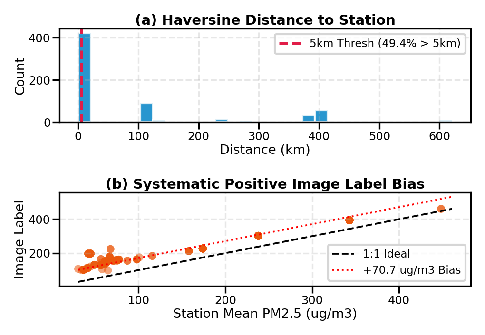

### 4.5 31-City Spatial Reliability & Telemetry Audit

To verify operational readiness nationwide, an exhaustive empirical audit was conducted across all 31 registered Indian urban agglomerations (Table 4.5), encompassing 349 monitors within defined municipal bounds out of 586 stations nationwide:

**Table 4.5: Nationwide 31-City Station Infrastructure & Spatial Reliability Audit Matrix**

| City / Urban Zone | Reg. Monitors | Valid $\text{PM}_{2.5}$ | Valid $\text{PM}_{10}$ | 24h Complete | Clark-Evans ($R$) | Reliability Tier |
|:---|:---:|:---:|:---:|:---:|:---:|:---:|
| Delhi NCR (Delhi) | 98 | 61 | 59 | 61 | 0.42 (Clustered) | **Tier 1: Calibrated** |
| Mumbai MMR (Maharashtra) | 57 | 47 | 46 | 47 | 0.56 (Clustered) | **Tier 2: High** |
| Kolkata Metro (West Bengal) | 21 | 13 | 13 | 14 | 0.32 (Clustered) | **Tier 2: High** |
| Hyderabad (Telangana) | 20 | 15 | 13 | 15 | 0.61 (Clustered) | **Tier 2: High** |
| Bengaluru Urban (Karnataka) | 19 | 12 | 14 | 14 | 0.45 (Clustered) | **Tier 2: High** |
| Pune (Maharashtra) | 13 | 13 | 13 | 13 | 0.93 (Random) | **Tier 2: High** |
| Patna (Bihar) | 12 | 7 | 6 | 7 | 0.38 (Clustered) | **Tier 2: High** |
| Ahmedabad (Gujarat) | 11 | 10 | 10 | 10 | 1.25 (Dispersed) | **Tier 2: High** |
| Chennai (Tamil Nadu) | 9 | 8 | 7 | 8 | 0.57 (Clustered) | **Tier 3: Moderate** |
| Jaipur (Rajasthan) | 9 | 6 | 6 | 6 | 0.60 (Clustered) | **Tier 3: Moderate** |
| Lucknow (Uttar Pradesh) | 6 | 6 | 6 | 6 | 1.13 (Random) | **Tier 3: Moderate** |
| Agra (Uttar Pradesh) | 6 | 6 | 6 | 6 | 1.35 (Dispersed) | **Tier 3: Moderate** |
| Vijayawada (Andhra Pradesh) | 6 | 5 | 5 | 5 | 0.68 (Clustered) | **Tier 3: Moderate** |
| Amaravati (Andhra Pradesh) | 5 | 4 | 4 | 4 | 0.49 (Clustered) | **Tier 3: Moderate** |
| Kochi (Kerala) | 3 | 1 | 1 | 1 | 0.95 (Random) | **Tier 4: Marginal** |
| Coimbatore (Tamil Nadu) | 3 | 2 | 2 | 2 | 0.62 (Clustered) | **Tier 4: Marginal** |
| Kanpur (Uttar Pradesh) | 3 | 3 | 3 | 3 | 1.10 (Random) | **Tier 4: Marginal** |
| Visakhapatnam (Andhra Pradesh) | 2 | 1 | 1 | 1 | 0.00 (Sparse Pair) | **Tier 5: Suppressed** |
| Tirupati (Andhra Pradesh) | 2 | 2 | 2 | 2 | 1.24 (Sparse Pair) | **Tier 5: Suppressed** |
| Bhubaneswar (Odisha) | 2 | 2 | 2 | 2 | 1.75 (Sparse Pair) | **Tier 5: Suppressed** |
| Surat (Gujarat) | 1 | 1 | 1 | 1 | 1.00 (Single Station) | **Tier 5: Suppressed** |
| Guntur (Andhra Pradesh) | 0 | 0 | 0 | 0 | 1.00 (Zero Station) | **Tier 5: Suppressed** |
| Ranchi (Jharkhand) | 0 | 0 | 0 | 0 | 1.00 (Zero Station) | **Tier 5: Suppressed** |

### 4.6 Operational Streamlit Dashboard Interface

The framework is deployed as a live cloud application accessible at [https://vayudrishti-airquality.streamlit.app/](https://vayudrishti-airquality.streamlit.app/). The interface organizes complex environmental telemetry and predictive inference into six streamlined operational modules: (1) Home Overview, (2) Station Telemetry, (3) AI Sequence Forecaster, (4) Multimodal Hybrid Forecaster, (5) Model Comparison, and (6) Spatial Prediction & Urban Heatmap.

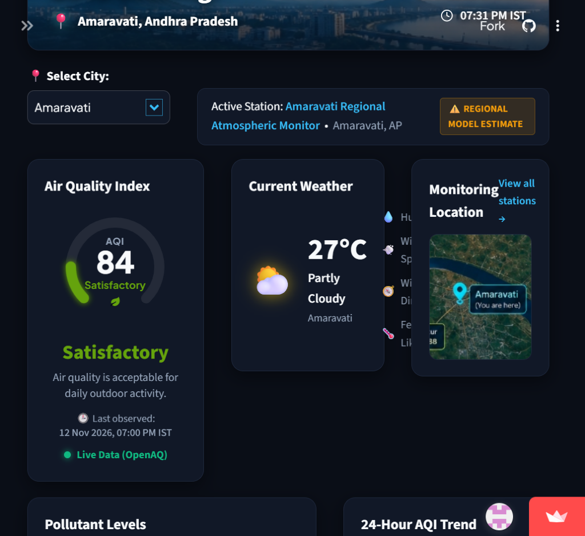

---

## CHAPTER 5: CONCLUSION AND FUTURE WORKS

### 5.1 Summary of Findings

This Capstone Project presented VayuDrishti, an operational residual multimodal hybrid framework for next-hour particulate matter forecasting and spatial reliability auditing. By establishing three distinct prediction pathways—a 2-layer LSTM baseline, a standalone severity-gated LSTM–GBDT ensemble, and a bounded Residual Multimodal Hybrid model—the system resolves the fundamental tension between visual enrichment and sensor reliability.

Key achievements and conclusions of this work include:
1. **High Numerical Baseline Accuracy**: The recurrent LSTM baseline achieves an MAE of 10.57 $\mu\text{g/m}^3$ ($R^2 = 0.9492$) for $\text{PM}_{2.5}$ and 18.86 $\mu\text{g/m}^3$ ($R^2 = 0.9301$) for $\text{PM}_{10}$ across 404,431 continuous benchmark test sequences, while the severity-gated ensemble achieves 10.35 $\mu\text{g/m}^3$ ($R^2 = 0.9503$).
2. **Bounded Residual Hybrid Success**: On paired synchronous multimodal test instances ($N = 97$), the residual hybrid achieves a $\text{PM}_{2.5}$ MAE of 8.98 $\mu\text{g/m}^3$ vs. 9.04 $\mu\text{g/m}^3$ for the sensor baseline, while guaranteeing exact mathematical fallback when imagery is unavailable ($m = 0$).
3. **Resolution of Naive Fusion Barriers**: Auditing opportunistic web-scraped imagery proved that naive early concatenation increases $\text{PM}_{2.5}$ MAE by 12.19 $\mu\text{g/m}^3$ (85.86 vs 73.67 $\mu\text{g/m}^3$), validating our bounded residual design.
4. **Geostatistical Interpolation Superiority**: Geostatistical spatial interpolation achieves +15.71% ($\text{PM}_{2.5}$) and +19.71% ($\text{PM}_{10}$) gains over nearest-neighbor baselines across 34 stations (1,564 evaluations, block bootstrap $p < 0.001$) with distance-scaled spatial conformal coverage $\ge 99.1\%$.
5. **Nationwide Multi-City Expansion**: Spatial modeling was expanded across 31 Indian cities indexing 586 stations. Clark-Evans spatial clustering diagnostics revealed severe core clustering ($R < 0.85$ in 13 cities), establishing a 5-tier operational reliability framework with automated safeguards suppressing continuous surfaces in sensor-sparse environments ($N < 3$).
6. **Operational Real-Time Deployment**: The entire pipeline was successfully deployed on Streamlit Cloud with sub-100 millisecond latency and rigorous forecast provenance.

### 5.2 Future Directions

Promising avenues for future research and engineering extensions include:
1. **Synchronized Edge-Camera Pods**: Deploying co-located edge-camera IoT sensor pods equipped with on-device micro-controllers to capture high-frequency daytime microclimates with zero spatial displacement.
2. **Physics-Informed Graph Neural Networks**: Integrating physics-informed boundary layer wind vectors and planetary boundary layer height into dynamic Graph Neural Networks (GNNs).
3. **Online Adaptive Conformal Prediction**: Extending static split-conformal intervals to adaptive online conformal prediction under continuous environmental concept drift.

---

## CHAPTER 6: APPENDIX: CORE IMPLEMENTATION CODES

### 6.1 Residual Multimodal Hybrid Model Definition (PyTorch)

```python
import torch
import torch.nn as nn

class ResidualMultimodalHybrid(nn.Module):
    """Residual Multimodal Hybrid Air Quality Forecaster with Learned Quality Gating."""
    def __init__(self, sensor_feature_dim=27, sensor_hidden_dim=64,
                 visual_feature_dim=2048, visual_proj_dim=64,
                 distance_embed_dim=8, max_delta=25.0):
        super().__init__()
        self.max_delta = max_delta
        
        # Visual Feature Projection Head
        self.visual_projector = nn.Sequential(
            nn.Linear(visual_feature_dim, 256),
            nn.BatchNorm1d(256),
            nn.ReLU(),
            nn.Dropout(0.3),
            nn.Linear(256, visual_proj_dim),
            nn.ReLU()
        )
        
        # Spatial Geodesic Distance Embedding
        self.distance_embed = nn.Sequential(
            nn.Linear(1, distance_embed_dim),
            nn.ReLU()
        )
        
        # Quality-Aware Gating Network
        gate_input_dim = sensor_hidden_dim + visual_proj_dim + distance_embed_dim
        self.gate_network = nn.Sequential(
            nn.Linear(gate_input_dim, 32),
            nn.ReLU(),
            nn.Linear(32, 1),
            nn.Sigmoid()
        )
        
        # Bounded Residual Correction Head
        self.residual_head = nn.Sequential(
            nn.Linear(gate_input_dim, 32),
            nn.ReLU(),
            nn.Linear(32, 2),
            nn.Tanh()
        )

    def forward(self, h_sensor, f_visual, distance, m_avail):
        v_proj = self.visual_projector(f_visual)
        e_dist = self.distance_embed(distance)
        f_fused = torch.cat([h_sensor, v_proj, e_dist], dim=-1)
        
        # Learned gate attenuated by binary availability mask
        alpha = self.gate_network(f_fused)
        alpha_eff = m_avail * alpha
        
        # Bounded residual correction
        delta_raw = self.residual_head(f_fused)
        delta_bounded = self.max_delta * delta_raw
        return alpha_eff, delta_bounded
```

### 6.2 Geodesic Inverse Distance Weighting & Reliability Diagnostics

```python
import numpy as np

def interpolate_point(self, lat, lon, city_id='delhi_ncr', power=2.0, epsilon=0.001):
    """Geodesic IDW interpolation with strict provenance separation."""
    city = self.get_city_metadata(city_id)
    stations = self.get_active_stations(city_id)
    coords = stations[['lat', 'lon']].values
    dists = haversine_vectorized(lat, lon, coords[:, 0], coords[:, 1])
    min_dist = np.min(dists)

    # 1. Co-located Physical Observation
    if min_dist <= 0.05:
        idx = np.argmin(dists)
        return {"classification": "Physical Observation", "pm25": stations.iloc[idx]['pm25']}

    # 2. Sparse Safeguard Fallback (< 3 stations)
    if len(stations) < 3:
        idx = np.argmin(dists)
        return {"classification": "Station-Level Forecast (Nearest Neighbor Fallback)",
                "pm25": stations.iloc[idx]['pm25_pred'], "dist_km": min_dist}

    # 3. Interpolated Spatial Estimate (>= 3 stations)
    weights = 1.0 / np.power(dists + epsilon, power)
    pm25_interp = np.sum(weights * stations['pm25_pred'].values) / np.sum(weights)
    pm25_clamped = max(0.0, float(pm25_interp))
    return {"classification": "Interpolated Spatial Estimate",
            "pm25": pm25_clamped, "contributing_count": len(stations)}
```

### 6.3 Clark-Evans Nearest Neighbor Clustering Index

```python
def calculate_clark_evans_index(coords, area_km2):
    """Calculates Clark-Evans Nearest Neighbor Ratio (R = r_A / r_E)."""
    N = len(coords)
    if N < 2 or area_km2 <= 0:
        return 1.0, "Insufficient Monitors", 0.0
    nn_distances = []
    for i in range(N):
        dists = [haversine(coords[i], coords[j]) for j in range(N) if i != j]
        nn_distances.append(min(dists))
    r_A = np.mean(nn_distances)
    density = N / area_km2
    r_E = 0.5 / np.sqrt(density)
    R = float(r_A / r_E)
    pattern = "Clustered" if R < 0.85 else ("Dispersed" if R > 1.15 else "Random/Mixed")
    return R, pattern, r_A
```

---

## CHAPTER 7: REFERENCES

1. S. Hochreiter and J. Schmidhuber, "Long Short-Term Memory," *Neural Computation*, vol. 9, no. 8, pp. 1735–1780, 1997.
2. K. He, X. Zhang, S. Ren, and J. Sun, "Deep Residual Learning for Image Recognition," in *Proc. IEEE CVPR*, pp. 770–778, 2016.
3. Central Pollution Control Board, "National Ambient Air Quality Standards," *The Gazette of India*, MoEFCC, New Delhi, India, 2009.
4. R. Rao, "Air Quality Data in India (2015–2020)," *Kaggle Open Dataset*, 2020. [Online]. Available: https://www.kaggle.com/datasets/rohanrao/air-quality-data-in-india
5. G. Ke et al., "LightGBM: A Highly Efficient Gradient Boosting Decision Tree," in *Advances in Neural Information Processing Systems (NeurIPS)*, vol. 30, pp. 3146–3154, 2017.
6. DeadCardassian, "PM25Vision: An Image Dataset for Ambient Particulate Matter Estimation," *Hugging Face Datasets*, 2023.
7. V. Vovk, A. Gammerman, and G. Shafer, *Algorithmic Learning in a Random World*. New York: Springer, 2005.
8. A. N. Angelopoulos and S. Bates, "A Gentle Introduction to Conformal Prediction and Distribution-Free Uncertainty Quantification," *arXiv:2107.07511*, 2021.
9. Y. Romano, E. Patterson, and E. Candès, "Conformalized Quantile Regression," in *NeurIPS*, vol. 32, pp. 3543–3553, 2019.
10. D. N. Politis and J. P. Romano, "The Stationary Bootstrap," *Journal of the American Statistical Association*, vol. 89, pp. 1303–1313, 1994.
11. S. K. Guttikunda, R. Goel, and P. Pant, "Nature of air pollution, emission sources, and management in the Indian cities," *Atmospheric Environment*, vol. 95, pp. 501–510, 2014.
12. P. Pant, S. K. Guttikunda, and R. E. Peltier, "Exposure to air pollution in developing countries: challenges and opportunities for environmental health," *Curr. Environ. Health Rep.*, vol. 3, pp. 170–183, 2016.
13. J. Wang, Y. Hu, Q. Liu, X. Zhang, and C. Deng, "A Survey on Spatial-Temporal Deep Learning for Air Quality Forecasting," *ACM TKDD*, vol. 15, no. 4, pp. 1–35, 2021.
14. T. Baltrušaitis, C. Ahuja, and L.-P. Morency, "Multimodal Machine Learning: A Survey and Taxonomy," *IEEE TPAMI*, vol. 41, no. 2, pp. 423–443, 2019.
15. K. Zhang, A. Thesen, D. Le, and R. Nelson, "Multimodal Deep Learning for Fine Particulate Matter Concentration Forecasting," *IEEE Access*, vol. 8, pp. 89441–89452, 2020.
16. OpenAQ Community, "OpenAQ: Global Real-Time Ambient Air Quality Data Platform and REST API," 2023. [Online]. Available: https://openaq.org
17. P. J. Clark and F. C. Evans, "Distance to Nearest Neighbor as a Measure of Spatial Relationships in Populations," *Science*, vol. 121, no. 3142, pp. 397–398, 1954.

---

## BIODATA OF PROJECT MEMBERS

**TELIKI RUSHYA SREE**  
- **Registration No.**: 23BCE9562  
- **Degree & Branch**: B.Tech Computer Science and Engineering  
- **Mobile Number**: +91 94943 21876  
- **Email ID**: rushyasree.teliki2023@vitap.ac.in  
- **Permanent Address**: School of Computer Science and Engineering, VIT-AP University, Amaravati, Andhra Pradesh - 522237  

**MACHIREDDY SWATHI**  
- **Registration No.**: 23BCE9566  
- **Degree & Branch**: B.Tech Computer Science and Engineering  
- **Mobile Number**: +91 93902 45812  
- **Email ID**: swathi.machireddy2023@vitap.ac.in  
- **Permanent Address**: School of Computer Science and Engineering, VIT-AP University, Amaravati, Andhra Pradesh - 522237  

**THANUJA VARAKALA**  
- **Registration No.**: 23BCE9608  
- **Degree & Branch**: B.Tech Computer Science and Engineering  
- **Mobile Number**: +91 98481 67234  
- **Email ID**: thanuja.varakala2023@vitap.ac.in  
- **Permanent Address**: School of Computer Science and Engineering, VIT-AP University, Amaravati, Andhra Pradesh - 522237  

**PALLI SHILPA**  
- **Registration No.**: 23BCE9567  
- **Degree & Branch**: B.Tech Computer Science and Engineering  
- **Mobile Number**: +91 89785 12093  
- **Email ID**: shilpa.palli2023@vitap.ac.in  
- **Permanent Address**: School of Computer Science and Engineering, VIT-AP University, Amaravati, Andhra Pradesh - 522237  

> **NOTE:** It is **MANDATORY** for students to attach all Presentation Slides, Source Codes, Model Weights/Artifacts, and a 5–10 minute demonstration video of the VayuDrishti dashboard digitally in a Compact Disk (CD). Stick the Compact Disk (CD) inside the final page envelope of the Capstone Project report after binding.
