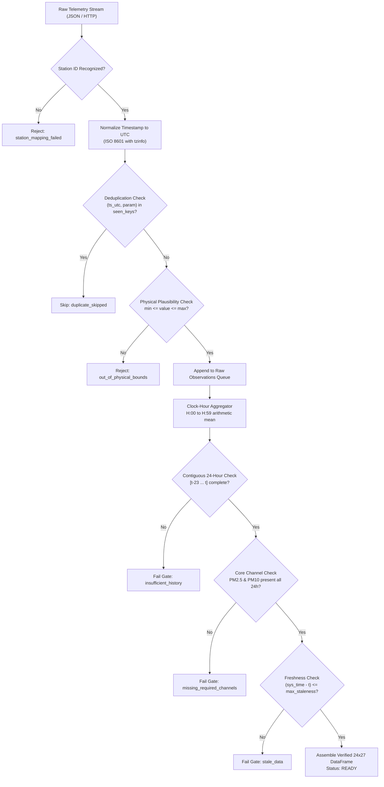

# VayuDrishti Phase 6B — Timestamp-Safe Rolling Buffer Architecture & Specification

**Document Version:** 1.0  
**Date:** November 2026  
**Module:** `src/data/live_rolling_buffer.py`  
**Status:** Canonical Implementation & Architectural Specification  

---

## 1. Executive Summary & Purpose

The VayuDrishti numerical next-hour air quality forecasting architecture (Mode A — Method B) requires an input tensor representing a **contiguous 24-hour window** of multivariate telemetry. In live operations, external public gateways such as OpenAQ API v3 deliver instantaneous, irregular, or sub-hourly readings rather than pre-assembled contiguous 24-hour histories.

`StationRollingBuffer` and `LiveRollingBufferRegistry` implement an isolated, deterministic, and timestamp-safe rolling buffer designed to bridge this gap without sacrificing research integrity:
1. **Zero Silent Imputation:** Missing hours are explicitly flagged (`insufficient_history`), preventing artificial manufacturing or forward-filling of missing observations.
2. **Deterministic Hourly Aggregation:** Sub-hourly readings (e.g., recorded at minutes :15, :30, :45) are aggregated using an explicit arithmetic mean policy for clock hour $[H:00, H:59]$ and anchored at $H:00$ UTC.
3. **Strict Deduplication & Plausibility:** Repeated observations with identical timestamps and channels are skipped; readings outside atmospheric physical plausibility limits are rejected.
4. **Leakage Elimination:** Target-hour ($t+1$) and future observations are strictly quarantined from the 24-hour input sequence.
5. **Multi-Station Isolation:** Each monitoring station operates in an independent, isolated buffer partition within the global registry.
6. **Separate Model Schema Readiness:** Distinct readiness flags are maintained for the Historical Baseline (27 channels) and the Post-2020 Adapted Model (49 features).

---

## 2. Mathematical Formalism & Aggregation Pipeline



### 2.1 Timezone Normalization
All timestamps ingested into `StationRollingBuffer` are strictly normalized to **UTC** (`timezone.utc`). Indian Standard Time (IST = UTC + 05:30) is preserved as display metadata:
$$t_{\text{UTC}} = t_{\text{IST}} - 5\text{h } 30\text{m}$$
Inputs supplied as ISO strings (`2026-11-05T06:00:00Z` or `2026-11-05T11:30:00+05:30`), Python `datetime` objects, or Pandas `Timestamp` objects are converted to timezone-aware UTC datetime instances.

### 2.2 Sub-Hourly to Hourly Aggregation Policy
For a given station $s$ and parameter $p$, let $\{v_1, v_2, \dots, v_K\}$ be the $K$ valid sub-hourly observations recorded within the clock-hour interval $[H:00:00, H:59:59.999]$ UTC. The aggregated hourly value $\bar{x}_{H}^{(p)}$ is defined deterministically as:
$$\bar{x}_{H}^{(p)} = \frac{1}{K}\sum_{k=1}^K v_k$$
- If $K = 0$, the parameter is absent for hour $H$, and no synthetic substitution occurs.
- If $K \ge 1$, the value is recorded at timestamp $H:00:00$ UTC.
- The sample count $K$ is retained in metadata for data provenance.

### 2.3 Physical Atmospheric Bounds
Every candidate reading is checked against established atmospheric and instrument physical boundaries:

| Parameter | Canonical Name | Min Valid | Max Valid | Unit | Physical Rationale |
| :--- | :--- | :---: | :---: | :---: | :--- |
| $\text{PM}_{2.5}$ | `PM2.5` | 0.0 | 1000.0 | $\mu\text{g/m}^3$ | Ambient optical particle counter limits |
| $\text{PM}_{10}$ | `PM10` | 0.0 | 1500.0 | $\mu\text{g/m}^3$ | Beta-attenuation particulate ceiling |
| $\text{NO}$ | `NO` | 0.0 | 1000.0 | $\mu\text{g/m}^3$ | Chemiluminescence detector limit |
| $\text{NO}_2$ | `NO2` | 0.0 | 1000.0 | $\mu\text{g/m}^3$ | Photolytic converter ceiling |
| $\text{CO}$ | `CO` | 0.0 | 100.0 | $\text{mg/m}^3$ | NDIR non-dispersive infrared limit |
| $\text{SO}_2$ | `SO2` | 0.0 | 1000.0 | $\mu\text{g/m}^3$ | UV fluorescence analyzer limit |
| $\text{O}_3$ | `O3` | 0.0 | 1000.0 | $\mu\text{g/m}^3$ | UV photometric analyzer ceiling |
| Ambient Temp | `temperature_C` | -20.0 | 60.0 | $^\circ\text{C}$ | Indian climatological range |
| Relative Humidity | `relative_humidity` | 0.0 | 100.0 | $\%$ | Hygrometric physical percentage |
| Wind Speed | `wind_speed` | 0.0 | 60.0 | $\text{m/s}$ | Anemometer physical ceiling |
| Wind Direction | `wind_direction` | 0.0 | 360.0 | Degrees | Azimuth range |

Readings falling outside these bounds or containing non-numeric strings (`SENSOR_TIMEOUT`, `CAL_ERROR`, `NaN`, `Inf`) are rejected immediately with status `rejected`.

---

## 3. Contiguous Sequence Verification & Readiness Gates

To guarantee that incomplete telemetry never triggers false model inferences, `check_readiness()` evaluates five sequential gates:

### Gate 1: Station Identity & Catalog Mapping
The station ID is checked against the verified CAAQMS station registry (`data/processed/location_catalog.csv`):
- If the station is unknown or maps to a distant coordinate (> 25 km), readiness fails with:
  `reason = "station_mapping_failed"`

### Gate 2: Anchor Hour & Strict Future Quarantine
Let $t$ be the designated forecast anchor hour (issue time).
- The forecast target is strictly defined as $t + 1\text{ hour}$.
- The input sequence window is strictly bounded to the 24 hours preceding and including $t$:
  $$\mathcal{T}_{\text{input}} = \{t - 23\text{h}, t - 22\text{h}, \dots, t - 1\text{h}, t\}$$
- Observations timestamped at $t + 1\text{h}$ (the target hour) or $t > t$ are quarantined from the input window, preventing temporal leakage.

### Gate 3: Contiguous 24-Hour Sequence Completeness
Every hour $h \in \mathcal{T}_{\text{input}}$ must exist in the hourly aggregate cache:
- If $|\mathcal{T}_{\text{input}} \cap \text{available\_hours}| < 24$, readiness fails with:
  `reason = "insufficient_history"`
- The diagnostic reports exact missing hours count and the earliest missing timestamp.

### Gate 4: Core Channel Completeness
Both $\text{PM}_{2.5}$ and $\text{PM}_{10}$ must be present in every one of the 24 hours in $\mathcal{T}_{\text{input}}$:
- If either particulate pollutant has a dropout for even 1 hour, readiness fails with:
  `reason = "missing_required_channels"`

### Gate 5: Freshness & Maximum Staleness Ceiling
The age of the newest observation in the window relative to system clock $\tau_{\text{sys}}$ is evaluated:
$$\Delta\tau = \frac{\tau_{\text{sys}} - t}{3600.0} \text{ hours}$$
- If $\Delta\tau > \tau_{\text{max}}$ (default $\tau_{\text{max}} = 3.0\text{ hours}$), readiness fails with:
  `reason = "stale_data"`

---

## 4. Multi-Model Schema Separation

The buffer separates schema readiness evaluation based on model requirements:

| Dimension | Historical Baseline / Ensemble | Post-2020 Adapted Severity-Gated |
| :--- | :--- | :--- |
| **Model Checkpoint** | `best_lstm_model.pt` + `best_gbdt_pm25.joblib` | `best_finetuned_lstm.pt` + `adapted_gbdt_pm25.joblib` |
| **Input Feature Size** | 27 channels $\times 24$ hours ($24 \times 27$) | 49 tabular features + $24 \times 27$ LSTM tensor |
| **Required Live Channels** | PM2.5, PM10 | PM2.5, PM10 |
| **Unobserved Channels** | 18 channels (NO, NO2, NOx, NH3, CO, SO2, O3, Benzene, Toluene, Xylene, Met) | Excluded from GBDT (native NaN support in `HistGradientBoosting`); LSTM uses documented training medians |
| **Imputation Disclosure** | Explicitly reported in `unobserved_channels_imputed` | Explicitly reported; GBDT is 100% particulate & lag-derived |
| **Readiness Flag** | `historical_ready: bool` | `adapted_ready: bool` |

---

## 5. Structured Diagnostic Output Schema

When `check_readiness()` or `runner.check_live_readiness()` is executed, it returns a structured diagnostic:

```json
{
  "is_ready": true,
  "status": "ready",
  "reason": null,
  "station_id": "AP001",
  "anchor_hour_utc": "2026-11-05T06:00:00Z",
  "target_hour_utc": "2026-11-05T07:00:00Z",
  "staleness_hours": 0.17,
  "available_hours_count": 24,
  "missing_hours_count": 0,
  "trial_enabled": false,
  "historical_ready": true,
  "adapted_ready": true,
  "observed_channels": [
    "PM10",
    "PM2.5"
  ],
  "unobserved_channels_imputed": [
    "Benzene", "CO", "NH3", "NO", "NO2", "NOx", "O3", "SO2", "Toluene", "Xylene",
    "dewpoint_C", "precipitation_mm", "relative_humidity", "temperature_C", "wind_speed"
  ],
  "dataframe_24h": "<DataFrame 24 rows x 4 columns: PM2.5, PM10, Datetime, StationId>"
}
```

If readiness fails, `is_ready` is `false`, `dataframe_24h` is `null`, and a clear canonical reason code is supplied (`"insufficient_history"`, `"missing_required_channels"`, `"stale_data"`, or `"station_mapping_failed"`).
