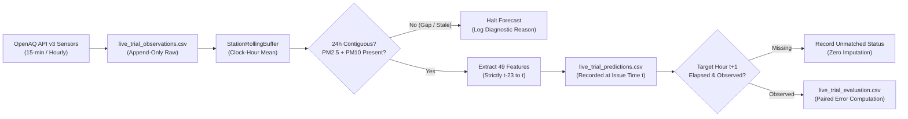

# VayuDrishti Longitudinal Live Forecasting Dataset Schema

**Document Version:** 1.0  
**Phase:** Phase 10 — Longitudinal Live Monitoring & Research Dataset Preservation  
**Pipeline:** `adapted_gbdt_only` (49 Reduced Tabular Features)  
**Telemetry Source:** OpenAQ API v3 (Official CPCB / State Pollution Control Board CAAQMS Feeds)  

---

## 1. Overview & Data Architecture

The VayuDrishti longitudinal live forecasting dataset consists of three append-only CSV tables and an operational state JSON file:

1. [`live_trial_observations.csv`](file:///e:/Documents/multimodal_air_quality_vscode_starter/experiments/recent_data_audit/live_trial_observations.csv): Raw, sub-hourly sensor readings ingested directly from OpenAQ API v3.
2. [`live_trial_predictions.csv`](file:///e:/Documents/multimodal_air_quality_vscode_starter/experiments/recent_data_audit/live_trial_predictions.csv): One-hour-ahead ($t+1$) forecasts and persistence baselines generated strictly at forecast issue time $t$.
3. [`live_trial_evaluation.csv`](file:///e:/Documents/multimodal_air_quality_vscode_starter/experiments/recent_data_audit/live_trial_evaluation.csv): Paired target observations and prediction residuals matched strictly after clock hour $t+1$ has elapsed.
4. [`collector_state.json`](file:///e:/Documents/multimodal_air_quality_vscode_starter/experiments/recent_data_audit/collector_state.json): Operational execution metadata, station counters, and API outage event logs.



---

## 2. Table Specifications & Data Dictionaries

### 2.1 Raw Telemetry: `live_trial_observations.csv`
Stores un-curated, validated sensor measurements in chronological UTC order.

| Column Name | Data Type | Units / Format | Allowed Values | Nullable | Description |
| :--- | :--- | :--- | :--- | :---: | :--- |
| `station_id` | String | Categorical | `AP001`, `AP005`, `DL002`, `DL008` | No | CPCB CAAQMS monitoring station identifier. |
| `observation_time_utc` | String | ISO 8601 (`YYYY-MM-DDTHH:MM:SSZ`) | Valid UTC timestamp | No | Observation timestamp reported by telemetry channel. |
| `parameter` | String | Categorical | `PM2.5`, `PM10` | No | Atmospheric pollutant channel name. |
| `value` | Float | $\mu\text{g/m}^3$ | $0.0 \le \text{PM}_{2.5} \le 1000.0$<br>$0.0 \le \text{PM}_{10} \le 1500.0$ | No | Validated numeric concentration reading. |
| `unit` | String | Text | `ug/m3` | No | Physical concentration measurement unit. |
| `ingestion_status` | String | Categorical | `ingested` | No | Status tag confirming successful bounds check. |

*Primary Deduplication Key*: `(station_id, observation_time_utc, parameter)`

---

### 2.2 Forecast Provenance: `live_trial_predictions.csv`
Records every forward-looking forecast issued at anchor time $t$, capturing full provenance and input range before target observations arrive.

| Column Name | Data Type | Units / Format | Allowed Values | Nullable | Description |
| :--- | :--- | :--- | :--- | :---: | :--- |
| `forecast_id` | String | UUID / Format string | `fc_{station}_{issue_time}` | No | Globally unique forecast execution identifier. |
| `station_id` | String | Categorical | `AP001`, `AP005`, `DL002`, `DL008` | No | Target monitoring station identifier. |
| `issue_time_utc` | String | ISO 8601 | Hourly clock anchor (`HH:00:00Z`) | No | Forecast issue timestamp ($t$). |
| `target_time_utc` | String | ISO 8601 | Exactly $t + 1\ \text{hour}$ | No | Target forecast horizon timestamp ($t+1$). |
| `input_start_utc` | String | ISO 8601 | Exactly $t - 23\ \text{hours}$ | Yes* | Oldest observation timestamp in the 24h sequence. |
| `input_end_utc` | String | ISO 8601 | Equals `issue_time_utc` ($t$) | Yes* | Most recent observation timestamp in sequence. |
| `model_name` | String | Text | `adapted_gbdt_only` | No | Forecasting model architecture identifier. |
| `checkpoint_sha256_pm25` | String | Hex (16 chars) | `982dbdfbf61db4ba` | Yes* | Truncated SHA-256 hash of PM2.5 GBDT weights. |
| `checkpoint_sha256_pm10` | String | Hex (16 chars) | `e951a12b7e2195ca` | Yes* | Truncated SHA-256 hash of PM10 GBDT weights. |
| `feature_schema_version` | String | Text | `v2-49feat` | Yes* | Feature manifest version used for inference. |
| `pred_pm25` | Float | $\mu\text{g/m}^3$ | $\ge 0.0$ | No | Standalone GBDT next-hour forecast for PM2.5. |
| `pred_pm10` | Float | $\mu\text{g/m}^3$ | $\ge 0.0$ | No | Standalone GBDT next-hour forecast for PM10. |
| `persistence_pm25` | Float | $\mu\text{g/m}^3$ | $\ge 0.0$ | No | Causal persistence baseline: $\text{PM}_{2.5}(t)$. |
| `persistence_pm10` | Float | $\mu\text{g/m}^3$ | $\ge 0.0$ | No | Causal persistence baseline: $\text{PM}_{10}(t)$. |
| `data_source` | String | Text | `OpenAQ API v3 CAAQMS Telemetry` | Yes* | Provenance origin of input telemetry. |
| `quality_status` | String | Text | `verified_contiguous_24h` | Yes* | Quality flag confirming 24 contiguous preceding hours. |
| `status` | String | Categorical | `forecast_generated`, `target_missing` | No | Operational lifecycle state of forecast. |

*\* Note: Fields marked with asterisk were added in Phase 10 provenance enrichment; historical Phase 8 rows preserve empty/null values for backwards compatibility without retroactively rewriting existing files.*

*Primary Deduplication Key*: `forecast_id`

---

### 2.3 Paired Ground-Truth Evaluation: `live_trial_evaluation.csv`
Records verified ground-truth observations matched to pending forecasts after the target clock hour has elapsed.

| Column Name | Data Type | Units / Format | Allowed Values | Nullable | Description |
| :--- | :--- | :--- | :--- | :---: | :--- |
| `match_id` | String | Text | `eval_{station}_{target_time}` | No | Globally unique evaluation pair identifier. |
| `forecast_id` | String | Text | Matches `live_trial_predictions.csv` | No | Foreign key linking to forecast record. |
| `station_id` | String | Categorical | `AP001`, `AP005`, `DL002`, `DL008` | No | Monitoring station identifier. |
| `target_time_utc` | String | ISO 8601 | Clock hour ($t+1$) | No | Ground-truth observation timestamp. |
| `actual_pm25` | Float | $\mu\text{g/m}^3$ | $0.0 \le \text{PM}_{2.5} \le 1000.0$ | No | Observed ground truth for PM2.5. |
| `actual_pm10` | Float | $\mu\text{g/m}^3$ | $0.0 \le \text{PM}_{10} \le 1500.0$ | No | Observed ground truth for PM10. |
| `pred_pm25` | Float | $\mu\text{g/m}^3$ | $\ge 0.0$ | No | Standalone GBDT forecast for PM2.5. |
| `pred_pm10` | Float | $\mu\text{g/m}^3$ | $\ge 0.0$ | No | Standalone GBDT forecast for PM10. |
| `persistence_pm25` | Float | $\mu\text{g/m}^3$ | $\ge 0.0$ | No | Persistence baseline value for PM2.5. |
| `persistence_pm10` | Float | $\mu\text{g/m}^3$ | $\ge 0.0$ | No | Persistence baseline value for PM10. |
| `gbdt_err_pm25` | Float | $\mu\text{g/m}^3$ | Signed float | No | GBDT PM2.5 signed error: $\text{pred} - \text{actual}$. |
| `gbdt_err_pm10` | Float | $\mu\text{g/m}^3$ | Signed float | No | GBDT PM10 signed error: $\text{pred} - \text{actual}$. |
| `pers_err_pm25` | Float | $\mu\text{g/m}^3$ | Signed float | No | Persistence PM2.5 signed error: $\text{pers} - \text{actual}$. |
| `pers_err_pm10` | Float | $\mu\text{g/m}^3$ | Signed float | No | Persistence PM10 signed error: $\text{pers} - \text{actual}$. |
| `gbdt_abs_err_pm25` | Float | $\mu\text{g/m}^3$ | $\ge 0.0$ | No | GBDT PM2.5 absolute error: $|\text{pred} - \text{actual}|$. |
| `gbdt_abs_err_pm10` | Float | $\mu\text{g/m}^3$ | $\ge 0.0$ | No | GBDT PM10 absolute error: $|\text{pred} - \text{actual}|$. |
| `pers_abs_err_pm25` | Float | $\mu\text{g/m}^3$ | $\ge 0.0$ | No | Persistence PM2.5 absolute error: $|\text{pers} - \text{actual}|$. |
| `pers_abs_err_pm10` | Float | $\mu\text{g/m}^3$ | $\ge 0.0$ | No | Persistence PM10 absolute error: $|\text{pers} - \text{actual}|$. |

*Primary Deduplication Key*: `match_id`

---

### 2.4 Operational State: `collector_state.json`
Maintains persistent collector runtime status, run counters, station diagnostics, and API outage event logs.

```json
{
  "collector_version": "v1.0-longitudinal",
  "trial_phase": "Phase 10: Longitudinal Live Monitoring",
  "created_at_utc": "2026-11-05T10:41:40.000000+00:00",
  "last_run_start_utc": "2026-11-05T10:41:40.000000+00:00",
  "last_run_end_utc": "2026-11-05T10:41:45.000000+00:00",
  "total_runs": 1,
  "total_observations_ingested": 6207,
  "total_predictions_generated": 420,
  "total_targets_matched": 418,
  "unmatched_predictions_count": 2,
  "api_outages_logged": [],
  "station_telemetry_status": {
    "AP005": {
      "raw_observation_count": 1081,
      "hourly_bins_count": 148,
      "predictions_count": 33,
      "evaluations_count": 33
    },
    "AP001": {
      "raw_observation_count": 1633,
      "hourly_bins_count": 225,
      "predictions_count": 149,
      "evaluations_count": 149
    },
    "DL008": {
      "raw_observation_count": 1741,
      "hourly_bins_count": 235,
      "predictions_count": 107,
      "evaluations_count": 105
    },
    "DL002": {
      "raw_observation_count": 1752,
      "hourly_bins_count": 236,
      "predictions_count": 131,
      "evaluations_count": 131
    }
  }
}
```

---

## 3. Station Metadata Directory

| Station ID | Station Name | City | State | Lat | Lon | OpenAQ Loc ID | PM2.5 Sensor ID | PM10 Sensor ID |
| :--- | :--- | :--- | :--- | :---: | :---: | :---: | :---: | :---: |
| **`AP001`** | Secretariat, Amaravati - APPCB | Amaravati | Andhra Pradesh | 16.5151 | 80.5182 | 5408 | 12234948 | 12234947 |
| **`AP005`** | GVM Corporation, Visakhapatnam - APPCB | Visakhapatnam | Andhra Pradesh | 17.7200 | 83.3000 | 5628 | 12235460 | 12235459 |
| **`DL002`** | Anand Vihar, Delhi - DPCC | Delhi | Delhi | 28.6476 | 77.3158 | 235 | 12235610 | 12235609 |
| **`DL008`** | DTU, Delhi - CPCB | Delhi | Delhi | 28.7500 | 77.1113 | 5626 | 12234760 | 12234759 |

---

## 4. Frozen Checkpoint Manifest

The standalone adapted GBDT forecaster relies strictly on the following frozen model checkpoints:

- **PM2.5 Regressor**: `experiments/recent_data_audit/checkpoints/adapted_gbdt_pm25.joblib`
  - *SHA-256*: `982dbdfbf61db4ba937a289860e8297bb482f3b79060af2c173f83476ad2225c`
  - *Size*: $366,670\ \text{bytes}$
  - *Algorithm*: HistGradientBoostingRegressor (scikit-learn)
- **PM10 Regressor**: `experiments/recent_data_audit/checkpoints/adapted_gbdt_pm10.joblib`
  - *SHA-256*: `e951a12b7e2195cae81eb20511ea635c2466d5e42208420382b09ed1a15743aa`
  - *Size*: $410,254\ \text{bytes}$
  - *Algorithm*: HistGradientBoostingRegressor (scikit-learn)
