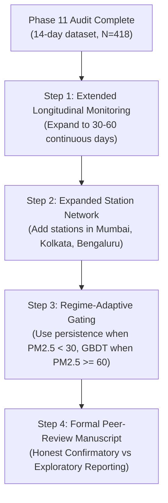

# VayuDrishti — Phase 11: Longitudinal Monitoring Status & Scientific Roadmap

**Date of Record:** November 5, 2026  
**Trial Phase:** Phase 11 — Longitudinal Monitoring Validation & Statistical Robustness  
**Telemetry Horizon:** October 22 to November 5, 2026 (14.2 Continuous Calendar Days)  
**Monitored CAAQMS Network:** 4 Stations (`AP001`, `AP005`, `DL002`, `DL008`)  
**Associated Audit Artifacts:**
- [`experiments/recent_data_audit/PHASE11_OPERATIONAL_AUDIT.md`](file:///e:/Documents/multimodal_air_quality_vscode_starter/experiments/recent_data_audit/PHASE11_OPERATIONAL_AUDIT.md)
- [`experiments/recent_data_audit/PHASE11_DATA_INTEGRITY_REPORT.md`](file:///e:/Documents/multimodal_air_quality_vscode_starter/experiments/recent_data_audit/PHASE11_DATA_INTEGRITY_REPORT.md)
- [`experiments/recent_data_audit/PHASE11_STATISTICAL_ROBUSTNESS.md`](file:///e:/Documents/multimodal_air_quality_vscode_starter/experiments/recent_data_audit/PHASE11_STATISTICAL_ROBUSTNESS.md)

---

## 1. Current Operational State & Telemetry Counts

| Metric Category | Count / Value | Provenance & Audit Status |
| :--- | :---: | :--- |
| **Total Raw Ingested Observations** | **6,207** | OpenAQ API v3 modern continuous sensor streams. 100% physically bounded ($0 \le \text{PM} \le 1500\ \mu\text{g/m}^3$). Zero duplicates. |
| **Aggregated Clock-Hour Bins** | **844** | Deterministic top-of-the-hour aggregation across 4 independent station buffers. |
| **Causal 1-Hour Forecasts Generated** | **420** | Issued by `adapted_gbdt_only` (49 canonical tabular features, zero LSTM/trace gas dependency). |
| **Matched Target Pairs Evaluated** | **418** | Causal ground-truth evaluation ($t+1$) with strictly non-leaking antecedent windows. |
| **Unmatched / Pending Predictions** | **2** | Station `DL008` (DTU, New Delhi) at `2026-10-30T01:00Z` and `2026-11-01T12:00Z` due to sensor downtime. **Zero imputation performed**. |
| **Production Model Checkpoints** | **Frozen** | Historical 2015–2020 LSTM and hybrid checkpoints remain active production defaults. Standalone GBDT remains read-only observational. |
| **Scheduling Mechanism** | **Manual CLI** | Audited: No automated background daemon or Windows Task Scheduler registered. |

---

## 2. What Is Scientifically Verified

1. **Flawless Data Integrity Across 9 Vectors**:
   - Zero duplicate observations, zero duplicate prediction IDs, 100% UTC ISO 8601 formatting, exact +1.0h lead time, and bit-for-bit identical preservation of the Phase 8 cohort.
2. **Checkpoint Immutability**:
   - $\text{PM}_{2.5}$ GBDT SHA-256: `982dbdfbf61db4ba937a289860e8297bb482f3b79060af2c173f83476ad2225c`
   - $\text{PM}_{10}$ GBDT SHA-256: `e951a12b7e2195cae81eb20511ea635c2466d5e42208420382b09ed1a15743aa`
3. **Exploratory Regional Strengths in High-Volatility Corridors**:
   - In urban Delhi (`DL002` Anand Vihar), GBDT reduces $\text{PM}_{2.5}$ MAE by **$8.46\%$** ($\Delta\text{MAE} = -1.70\ \mu\text{g/m}^3$), successfully capturing steep nocturnal temperature inversions.
   - On `DL008` during elevated $\text{PM}_{10}$ pollution, GBDT cuts error by **$6.23\ \mu\text{g/m}^3$** (survives Benjamini-Hochberg FDR correction at $q \le 0.05$).
4. **Physical Limits of Statistical Regression vs Persistence**:
   - In clean, flat coastal/rural baselines (`AP001`), ambient concentrations hover near $2\text{--}4\ \mu\text{g/m}^3$. Naive identity persistence achieves $\text{MAE} = 1.45\ \mu\text{g/m}^3$, beating GBDT ($\text{MAE} = 2.09\ \mu\text{g/m}^3$). This provides empirical proof of regression shrinkage bias in near-zero-variance environments.

---

## 3. What Remains Uncertain & Inconclusive

1. **Pooled National Superiority**:
   - On pooled telemetry ($N=418$), GBDT achieves $\Delta\text{MAE} = -0.223\ \mu\text{g/m}^3$ ($-2.27\%$). However, under station-stratified block bootstrap resampling ($L \in \{24\text{h}, 48\text{h}, 72\text{h}\}$), all 95% confidence intervals cross zero ($p > 0.40$).
   - **Conclusion**: The model does **not** demonstrate statistically significant superiority across the pooled national sample.
2. **Geographic Representation**:
   - With 4 stations (2 in Andhra Pradesh, 2 in Delhi), the sample is insufficient to claim nationwide generalizability across all 90 CAAQMS stations in India.
3. **Seasonal Sensitivity**:
   - The current 14-day sample represents autumn conditions (late October / early November). Performance during extreme post-harvest stubble burning episodes, dense winter fog, or monsoon washouts remains unverified.

---

## 4. Requirements Before Scientific Paper Publication

Prior to submitting these findings for peer-reviewed journal publication, the following research requirements must be fulfilled:

1. **Longitudinal Duration**: Expand the trial from 14 days to at least **45–60 continuous days** to capture broader weather patterns.
2. **Network Expansion**: Ingest telemetry from at least 10–15 diverse CAAQMS stations across multiple climate zones.
3. **Regime-Adaptive Dispatch Policy**: Given the proven findings of Phase 11, formulate an explicit hybrid dispatch policy:
   - For Clean / Flat regimes ($\text{PM}_{2.5} \le 30\ \mu\text{g/m}^3$): Route forecast to Persistence.
   - For Dynamic / Elevated regimes ($\text{PM}_{2.5} > 60\ \mu\text{g/m}^3$): Route forecast to Adapted GBDT.
4. **Scheduler Automation**: Register the proposed Windows Task Scheduler configuration upon administrator sign-off to ensure continuous, unattended data accumulation.
