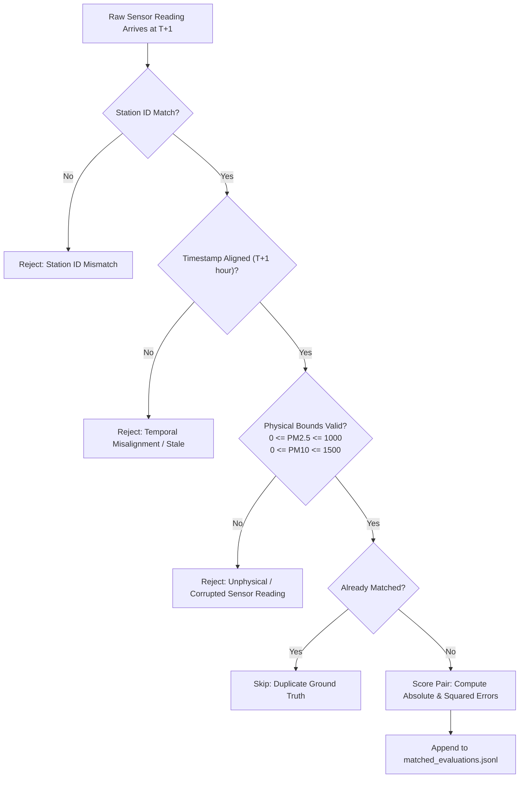

# VayuDrishti Phase 6 — Controlled Live Shadow Observation Plan

**Document Version:** 1.0  
**Date:** October 2026  
**Status:** Canonical Experimental Protocol  
**Scope:** Controlled, opt-in observational trial of the adapted severity-gated model alongside the production default model.

---

## 1. Executive Summary & Protocol Objectives

The VayuDrishti accuracy optimization journey demonstrated significant statistical gains for the adapted severity-gated model on historical (2019–2020) and recent (April–August 2025) holdout benchmarks:
- **Historical holdout:** PM2.5 MAE improved from 28.18 to 22.04 µg/m³; PM10 MAE improved from 51.52 to 43.83 µg/m³.
- **2025 recent holdout:** PM2.5 MAE improved by -1.82 µg/m³ (95% CI [-2.02, -1.63]); PM10 MAE improved by -4.01 µg/m³ (95% CI [-4.40, -3.61]).
- **Phase 5B verification:** Passed all end-to-end regression suites, verified 49-feature schema alignment, confirmed isolated shadow execution, and established a p95 dual-mode CPU latency of 149.8 ms (< 250 ms target).

**Phase 6 establishes a safe, non-invasive observational trial.**  
In accordance with research ethics and deployment safety rules:
1. **Zero Public Impact:** Production forecasts remain 100% driven by the historical production model. Public dashboards and API consumers never receive experimental forecasts.
2. **Opt-In Only:** The trial is disabled by default. It activates strictly via explicit local configuration or environment flag (`VAYUDRISHTI_SHADOW_TRIAL_ENABLED=1`).
3. **No Retraining:** Model checkpoints, architectures, and weights are strictly frozen.
4. **No Fabricated Telemetry:** Live accuracy cannot be claimed or simulated; metrics are computed only after real observations arrive and pass rigorous matching criteria.

---

## 2. Target Station Cohort & Telemetry Requirements

### 2.1 Target Station Cohort
The observational trial monitors the **85 matched CAAQMS stations** across India documented in `experiments/recent_data_audit/matched_stations.csv`. These represent diverse geographical and climatic zones:
- Northern / Indo-Gangetic Plain (e.g., Delhi, Anand Vihar, RK Puram, Lucknow, Patna)
- Coastal / Peninsular (e.g., Visakhapatnam GVM Corporation, Mumbai, Chennai)
- Western / Arid (e.g., Jaipur, Ahmedabad)
- Southern / Plateau (e.g., Bengaluru, Hyderabad)

### 2.2 The 24-Hour Contiguous Sequence Requirement
Both the production baseline and the adapted models operate under **Mode A (Sensor-Only Next-Hour Forecasting)**:
- **Input Dimension:** $24 \text{ hours} \times 27 \text{ features}$.
- **Features Required:** Hourly PM2.5, PM10, NO2, SO2, CO, OZONE, meteorological variables (temperature, relative humidity, wind speed, wind direction), cyclical temporal encodings, and derived lags.
- **Telemetry Buffer Constraint:** Because live OpenAQ v3 telemetry provides instantaneous snapshots rather than pre-assembled 24-hour histories, the trial runner requires an active rolling buffer. A forecast can only be evaluated once 24 contiguous, validated hourly observations have accumulated for that station.

---

## 3. Observational Cadence & Deduplication

### 3.1 Sampling Cadence
- **Issue Frequency:** Once per hour, executed at minute $T+05$ (e.g., 06:05 UTC) to allow regional data loggers to finalize hourly aggregates for hour $T$.
- **Forecast Horizon:** Next-hour target $t+1$ (e.g., for issue time 06:00 UTC, the forecast targets 07:00 UTC).
- **Timezone Storage:** All log records strictly record ISO 8601 UTC timestamps (e.g., `2026-10-27T06:00:00Z`). Local Indian Standard Time (IST = UTC + 05:30) is maintained as metadata for operator auditing.

### 3.2 Deduplication and Idempotency
To prevent double-counting or log pollution during server restarts or retry storms:
- Every forecast generation hashes a unique deduplication key:
  $$\text{dedup\_key} = \text{MD5}(\text{station\_id} \mathbin{\Vert} \text{issue\_time\_utc} \mathbin{\Vert} \text{"t+1"})$$
- The runner maintains an in-memory index of processed keys loaded from disk on startup.
- Duplicate requests return status `duplicate_skipped` with HTTP 200 without writing to disk.

---

## 4. Ground-Truth Matching & Quality Assurance Protocol

Forecasts cannot be scored immediately upon issuance. An observation arriving at $T+1$ is processed through the strict matching pipeline:



### 4.1 Strict Matching Criteria
1. **Station Identity:** Exact match between forecast `station_id` and telemetry station ID.
2. **Temporal Window:** The observation timestamp must match the forecast target hour within a $\pm 15\text{-minute}$ tolerance window.
3. **Physical Plausibility Gates:**
   - $0.0 \le \text{PM}_{2.5} \le 1,000.0 \ \mu\text{g/m}^3$
   - $0.0 \le \text{PM}_{10} \le 1,500.0 \ \mu\text{g/m}^3$
   - Stale / frozen readings (identical values for $> 6$ consecutive hours) are flagged and excluded from metric scoring.
4. **Single-Use Match:** Each forecast `record_id` can be matched exactly once. Subsequent matching attempts return `duplicate_skipped`.

---

## 5. Pre-Defined Evaluation Criteria & Success Metrics

Before collecting observational data, success and failure criteria are frozen to prevent p-hacking:

### 5.1 Primary Metrics
- **Paired Mean Absolute Error Difference ($\Delta\text{MAE}$):**
  $$\Delta\text{MAE} = \frac{1}{N}\sum_{i=1}^N \left(|y_i - \hat{y}_i^{\text{adapted}}| - |y_i - \hat{y}_i^{\text{prod}}|\right)$$
  - Target: $\Delta\text{MAE} \le -1.5 \ \mu\text{g/m}^3$ for PM2.5, $\le -2.0 \ \mu\text{g/m}^3$ for PM10.
- **Statistical Significance:**
  - Stationary block-bootstrap (block size = 24 hours, grouped by station, 2,000 resamples).
  - Upper bound of the 95% paired confidence interval must be strictly $< 0.0$.
- **Severe Pollution Subset ($\text{PM}_{2.5} > 250 \ \mu\text{g/m}^3$):**
  - Underprediction rate must not exceed 75% (historical baseline underpredicted 88.7%).
  - Severe MAE must demonstrate improvement over production baseline.
- **Latency & Reliability:**
  - Dual-mode p95 latency must remain $< 250 \text{ ms}$ on standard multi-core CPU.
  - Zero unhandled exceptions or service degradations.

### 5.2 Evaluation Milestones
| Milestone | Matched Pairs ($N$) | Objective | Action Trigger |
| :--- | :--- | :--- | :--- |
| **Phase 6A: Sanity** | 50 | Verify telemetry pipeline, matching alignment, zero memory leaks. | If failure rate $> 5\%$, pause and inspect data ingest. |
| **Phase 6B: Directional** | 200 | Initial directional evaluation of $\Delta\text{MAE}$ and error distribution. | If $\Delta\text{MAE} > +2.0 \ \mu\text{g/m}^3$, trigger investigation. |
| **Phase 6C: Definitive** | 1,000 | Definitive statistical significance test with paired bootstrap CI. | Formal deployment sign-off decision. |

---

## 6. Circuit Breakers & Operational Safety Guardrails

To ensure production stability, the observational trial runner includes automated safety trips:

1. **Automatic Trip (Error Spike):** If shadow execution fails with uncaught exceptions on $> 1\%$ of requests in a 1-hour window, shadow mode automatically disengages.
2. **Latency Trip:** If 5-minute rolling average latency exceeds 400 ms, shadow mode disengages to protect primary production forecasting.
3. **Manual Kill-Switch:**
   - Operators can instantly terminate shadow observation without restarting the server:
     ```python
     runner.disable_trial()
     ```
   - Or by setting `"enabled": false` in `experiments/recent_data_audit/shadow_trial_config.json`.
4. **Zero State Exposure:** The production response schema never leaks shadow fields unless `enable_shadow=True` is explicitly passed by authorized audit clients. Public API callers receive standard production contracts.
