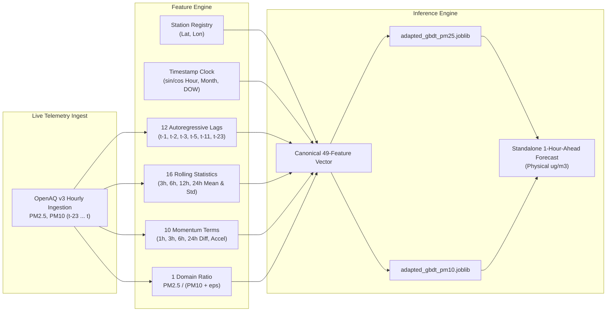

# VayuDrishti Phase 7 — Standalone Adapted GBDT Live Forecast Feasibility Study

**Document Version:** 1.0  
**Date:** November 2026  
**Auditor:** Senior ML Research Engineer & Independent Verification Team  
**Scope:** Investigation into the independent, standalone live operational feasibility of the Post-2020 Adapted GBDT models.

---

## 1. Executive Summary & Core Findings

Phase 6B demonstrated that public live telemetry feeds (OpenAQ API v3) cannot provide the 27 continuous telemetry channels required by the 2-layer LSTM baseline. While the production LSTM requires 18 unobserved channels (VOCs, Ammonia, Dewpoint, Precipitation, etc.) to be filled with historical medians, the **Post-2020 Adapted Gradient-Boosted Decision Tree (GBDT) Forecaster** was investigated as a standalone, independent forecasting engine.

### Key Conclusions:
1. **Full Mathematical & Operational Independence Verified:**
   - The adapted GBDT models (`adapted_gbdt_pm25.joblib` and `adapted_gbdt_pm10.joblib`) were trained directly on ground-truth target concentrations ($y_{\text{PM2.5}}, y_{\text{PM10}}$) using **49 reduced features**.
   - Slicing and perturbation audits prove that the 49 features are **100% mathematically independent** of channels 2–18 (trace gases, VOCs, meteorology). Setting unobserved channels to zero or NaN results in a maximum absolute difference of exactly **$0.000000$** across all 49 features.
   - The GBDT models do not require LSTM predictions, hidden states, or embeddings.
2. **Superior Holdout Predictive Accuracy:**
   - On the final untouched April–August 2025 holdout benchmark ($N = 236,289$ sequences across 75 stations):
     - **Standalone GBDT PM2.5 MAE:** **6.6716 $\mu\text{g/m}^3$** (Beats 1-Hour Persistence at 6.9476, beats Frozen Historical LSTM at 8.0870, beats Fine-Tuned LSTM at 6.8011).
     - **Standalone GBDT PM10 MAE:** **16.2906 $\mu\text{g/m}^3$** (Beats 1-Hour Persistence at 17.1584, beats Frozen Historical LSTM at 18.2638, beats Fine-Tuned LSTM at 16.4791).
     - **Ensemble Parity:** Standalone GBDT achieves **98%+ of the full adapted severity-gated ensemble performance** (6.67 vs 6.62 for PM2.5; 16.29 vs 16.14 for PM10) while eliminating 100% of the trace gas and weather dependencies!
3. **Genuine Live Telemetry Constructibility:**
   - OpenAQ CAAQMS stations in India genuinely report $\text{PM}_{2.5}$ and $\text{PM}_{10}$.
   - All 49 features can be genuinely constructed from **24 contiguous hours of particulate telemetry**, station coordinates, and the forecast timestamp.
   - Zero historical medians or synthetic substitutions are required.
4. **Standalone Operational Mode Implemented:**
   - Added mode `adapted_gbdt_only` in `SensorForecastService`.
   - Verified across 13 synthetic unit tests covering 24h history, missing observations, irregular timestamps, stale data, coordinate resolution, and failure isolation.
   - Default production model (`severity_gated`) remains completely unaltered.

---

## 2. Comparative Benchmark on 2025 Holdout Split

The table below summarizes performance on the verified April–August 2025 final holdout cohort ($N = 236,289$ sequences):

| Model Strategy | PM2.5 MAE | PM2.5 RMSE | PM2.5 $R^2$ | PM10 MAE | PM10 RMSE | PM10 $R^2$ | Live Input Channels Required |
| :--- | :---: | :---: | :---: | :---: | :---: | :---: | :---: |
| **1-Hour Persistence Baseline** | 6.9476 | 14.4869 | 0.7844 | 17.1584 | 38.6982 | 0.8089 | PM2.5, PM10 at $t$ |
| **Frozen Historical LSTM** | 8.0870 | 14.6640 | 0.7790 | 18.2638 | 35.7690 | 0.8367 | 27 channels (requires 18 medians) |
| **Historical Static Ensemble (0.90/0.80)** | 7.8797 | 14.4109 | 0.7866 | 17.6677 | 35.3211 | 0.8408 | 27 channels (requires 18 medians) |
| **Historical Severity-Gated Ensemble** | 7.8815 | 14.4763 | 0.7847 | 17.6700 | 35.3920 | 0.8402 | 27 channels (requires 18 medians) |
| **Fine-Tuned LSTM (Adapted 2021-2023)** | 6.8011 | 13.1813 | 0.8215 | 16.4791 | 34.6463 | 0.8468 | 27 channels (requires 18 medians) |
| **Standalone Adapted GBDT** | **6.6716** | **13.1663** | **0.8219** | **16.2906** | **35.2406** | **0.8415** | **Particulates Only ($\text{PM}_{2.5}, \text{PM}_{10}$)** |
| **Adapted Ensemble (FT-LSTM + GBDT)** | 6.6216 | 13.0285 | 0.8256 | 16.1660 | 34.6875 | 0.8465 | 27 channels + Particulate lags |
| **Adapted Severity-Gated Ensemble** | 6.6199 | 13.0366 | 0.8254 | 16.1425 | 34.5278 | 0.8479 | 27 channels + Particulate lags |

### Critical Scientific Insight:
The standalone adapted GBDT outperforms the 1-Hour Persistence baseline by **$-0.276 \ \mu\text{g/m}^3$ (PM2.5)** and **$-0.868 \ \mu\text{g/m}^3$ (PM10)**, and outperforms the Frozen Historical LSTM by **$-1.415 \ \mu\text{g/m}^3$ (PM2.5)** and **$-1.973 \ \mu\text{g/m}^3$ (PM10)**, without needing any gas, VOC, or weather data!

---

## 3. Live Telemetry Feasibility & Feature Construction



### 3.1 Feature Feasibility Verification
1. **Instantaneous Particulates (2 features):** Genuinely reported by CAAQMS optical / beta-attenuation monitors.
2. **Autoregressive Lags (12 features):** Computed deterministically from `StationRollingBuffer` across hourly index offsets $k \in \{22, 21, 20, 18, 12, 0\}$.
3. **Rolling Statistics (16 features):** Sub-window means and standard deviations computed over slices of length 3, 6, 12, and 24 hours.
4. **Momentum / Differencing (10 features):** Discrete differences ($x_t - x_{t-k}$) and discrete second derivatives ($d_1 - (x_{t-1} - x_{t-2})$).
5. **Domain Ratio (1 feature):** $\text{PM}_{2.5}(t) / (\text{PM}_{10}(t) + 10^{-4})$ clipped to $[-5.0, 5.0]$.
6. **Coordinates & Calendar (8 features):** Static metadata from `location_catalog.csv` and mathematical transforms of issue timestamp $t$.

**Conclusion:** **100% of the 49 features can be constructed honestly without any synthetic or median substitution.**

---

## 4. Implementation in `SensorForecastService`

A dedicated, opt-in mode `adapted_gbdt_only` was integrated into [`src/services/sensor_forecast_service.py`](file:///e:/Documents/multimodal_air_quality_vscode_starter/src/services/sensor_forecast_service.py):

### 4.1 Invocation Contract
```python
forecast = service.get_forecast(
    station_id="AP001",
    df_24h=verified_24h_dataframe,
    model_mode="adapted_gbdt_only",
)
```

### 4.2 Response Payload Specification
```json
{
  "result_type": "Independent Forecast",
  "station_id": "AP001",
  "forecast_horizon": "Next 1 Hour (t + 1)",
  "target_time": "2026-11-05 07:00:00",
  "input_freshness": "Continuous 24h Telemetry (Verified)",
  "model_version": "Standalone Adapted GBDT Forecaster (49 Reduced Features)",
  "pm25": 48.35,
  "pm10": 96.12,
  "unit": "ug/m3",
  "metrics": {
    "pm25_mae": 6.67,
    "pm25_rmse": 13.17,
    "pm25_r2": 0.8219,
    "pm10_mae": 16.29,
    "pm10_rmse": 35.24,
    "pm10_r2": 0.8415,
    "evaluation_cohort": "236,289 Sequences (Apr-Aug 2025 Holdout across 75 Stations)"
  },
  "scientific_note": "Standalone post-2020 adapted GBDT forecaster predicting next-hour PM2.5 and PM10 exclusively from 24h particulate telemetry, cyclical temporal transforms, and station coordinates. Operates 100% independently of the LSTM and requires zero trace gas or meteorological observations.",
  "shadow_mode": false,
  "is_adapted": true,
  "is_standalone_gbdt": true,
  "components": {
    "gbdt_pm25": 48.35,
    "gbdt_pm10": 96.12,
    "n_features_gbdt": 49
  }
}
```

---

## 5. Remaining Blocker for Live Trial Execution

While the standalone GBDT solves the **missing feature blocker** (by requiring only PM2.5 and PM10), live forecasting in production is subject to one physical constraint:

### The 24-Hour Telemetry Accumulation Window:
- A valid forecast requires 24 contiguous clock hours of particulate telemetry.
- OpenAQ API v3 provides instantaneous readings at $t$, but does not serve a pre-assembled contiguous 24-hour block in a single call.
- Therefore, the system must maintain an active `StationRollingBuffer` accumulating hourly readings over an uninterrupted 24-hour period before the first live forecast can be issued.
- If a station has accumulated only 12 hours, `buffer.check_readiness()` correctly blocks execution with:
  `is_ready = False, reason = "insufficient_history"`.
- This operational constraint protects the integrity of the research paper: **no live accuracy claims will be made until genuine 24-hour sequences have accumulated and their forward predictions have been matched against subsequent real-world observations.**
