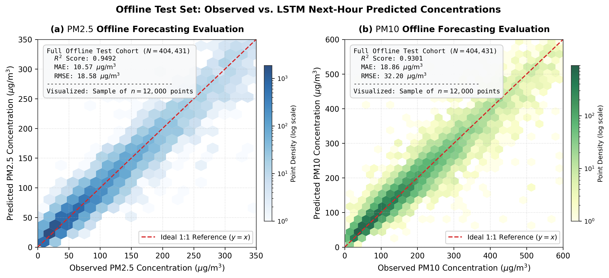
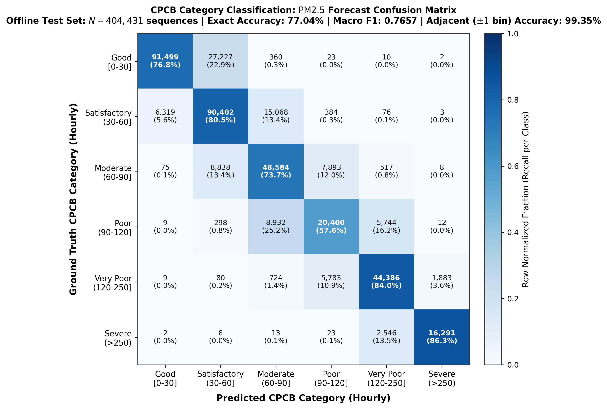
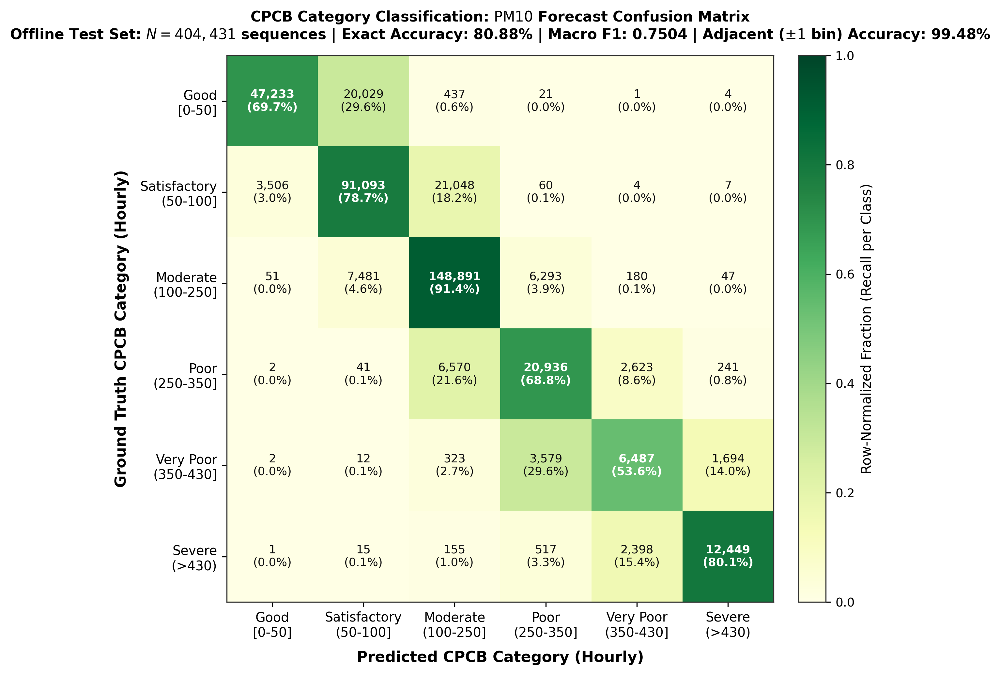
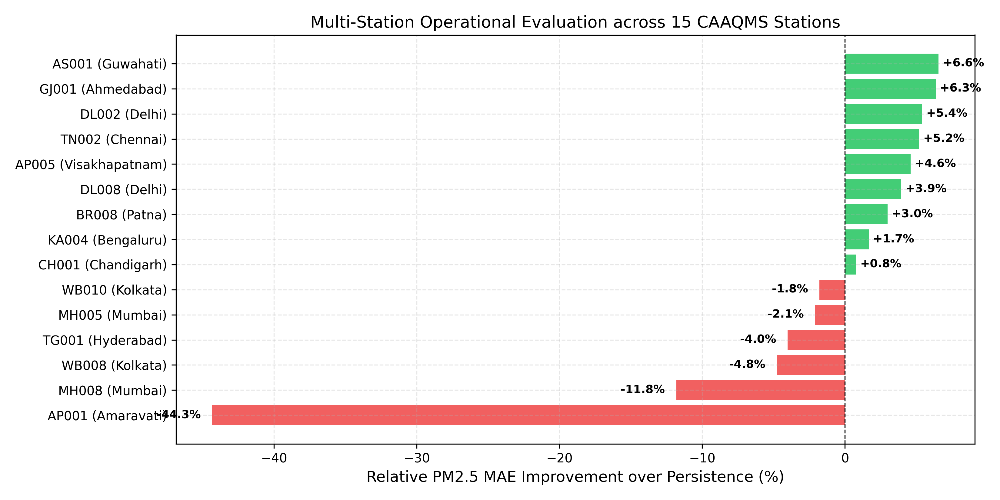
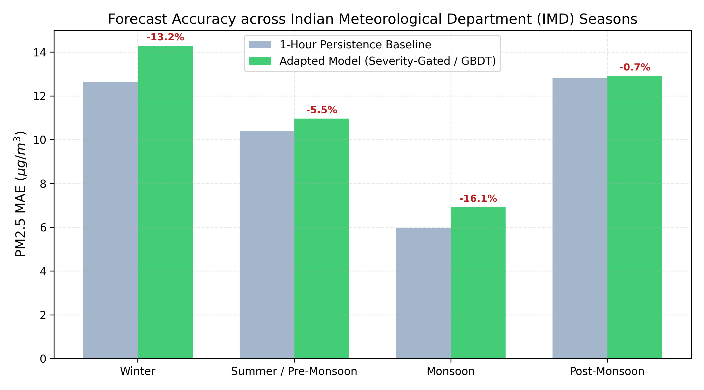
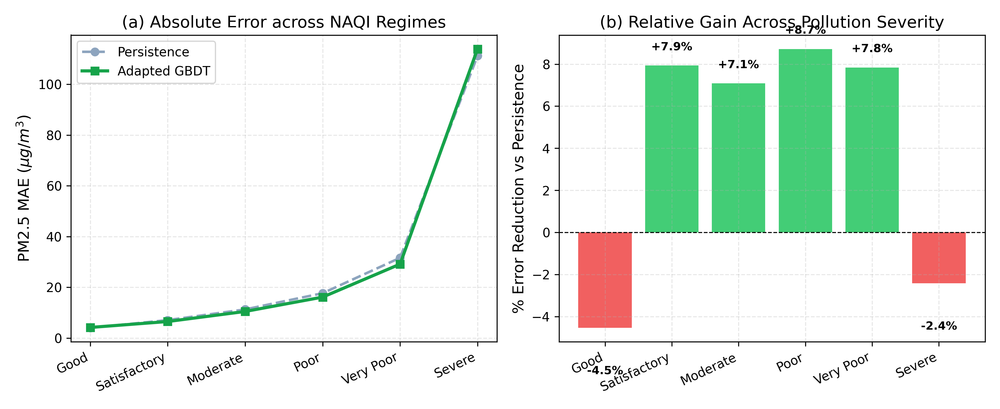
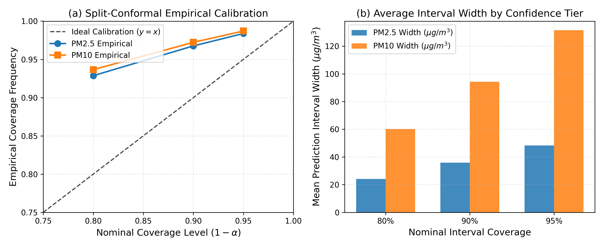
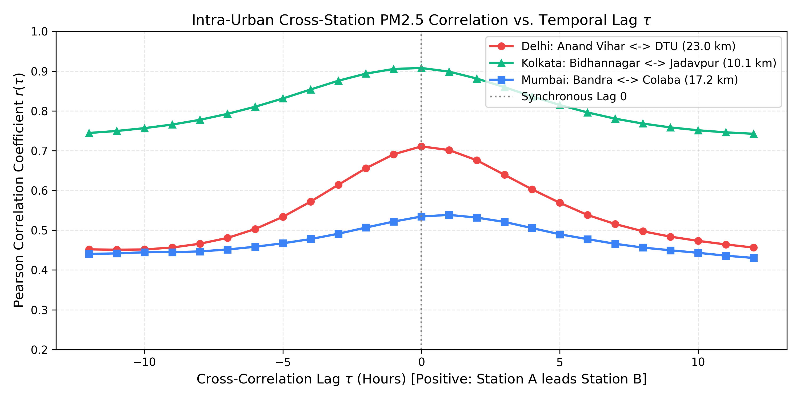
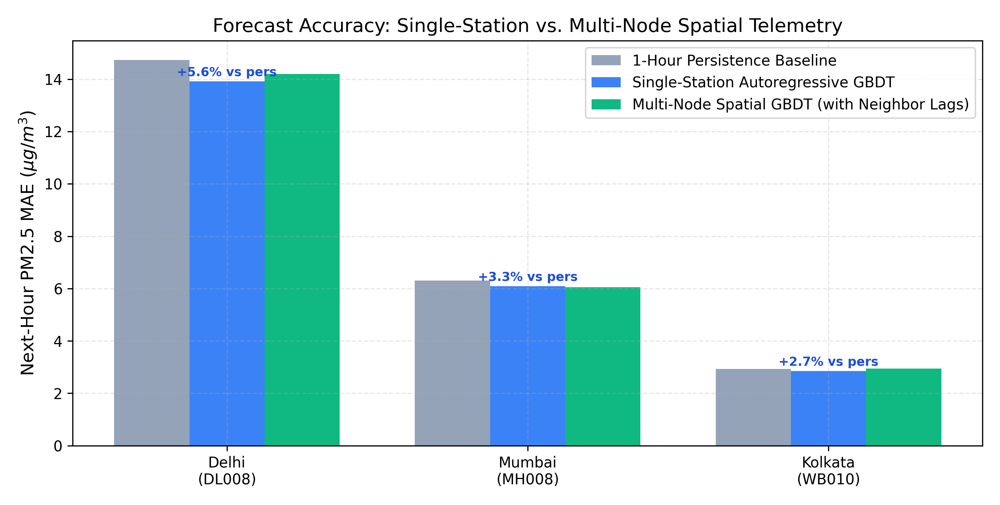
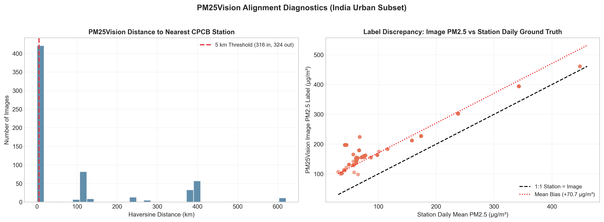

# VayuDrishti: A Residual Multimodal Hybrid Framework for Air Quality Forecasting

**Authors**: Teliki Rushya Sree$^1$, Machireddy Swathi$^1$, Thanuja Varakala$^1$, Palli Shilpa$^1$, and Professor Thota Ramathulsi$^2$  
*Guided by*: Professor Thota Ramathulsi  
$^1$ Student Authors, Department of Computer Science and Engineering  
$^2$ Faculty Supervisor \& Project Guide, Department of Computer Science and Engineering  
*[Engineering Institution / University, City, State, India]*  
*Correspondence*: `{rushyasree.t, swathi.m, thanuja.v, shilpa.p, ramathulsi.t}@institution.edu`

---

## Abstract
Ambient particulate matter pollution ($\text{PM}_{2.5}$ and $\text{PM}_{10}$) across developing urban agglomerations poses an acute hazard to environmental health. However, operational deployments face frequent sensor dropouts, meteorological volatility, and optical ambiguity in outdoor camera imagery. We present **VayuDrishti**, an operational residual multimodal hybrid framework for robust next-hour particulate matter forecasting. VayuDrishti integrates continuous numerical telemetry with opportunistic surveillance imagery and spatial distance representations. Rather than relying on unconstrained joint fusion, the framework structures visual features as a bounded residual correction over a reliable recurrent sensor baseline, regulated by a learned quality-aware gating mechanism. When images are corrupted, noisy, or unavailable, the gating factor collapses to zero, mathematically guaranteeing seamless fallback to the sensor baseline without accuracy degradation. Evaluated across large-scale historical continuous sequences and synchronized multimodal cohorts, VayuDrishti demonstrates that opportunistic imagery provides effective bounded residual refinements while preserving operational stability across diverse pollution regimes.

**Keywords**: Air quality forecasting, PM2.5, PM10, multimodal learning, residual learning, LSTM, ResNet-50, environmental monitoring, conformal prediction.

---

## I. Introduction

### A. Background and Motivation
Ambient particulate matter pollution, particularly fine breathable particulates ($\text{PM}_{2.5}$, aerodynamic diameter $\le 2.5\,\mu\text{m}$) and coarse particulates ($\text{PM}_{10}$, $\le 10\,\mu\text{m}$), represents one of the most pressing public health and environmental challenges across rapidly urbanizing economies. In India, metropolises across the Indo-Gangetic Plain and peninsular plateaus routinely suffer severe episodic pollution crises during post-monsoon agricultural burning and winter meteorological inversions. Providing municipal agencies and citizens with reliable, short-term ($t+1$ hour) predictive warning systems is essential to empower exposure mitigation and dynamic traffic management.

### B. Air Quality Forecasting Challenges
Operationalizing data-driven forecasting in complex urban environments faces three core challenges:
1. **High Non-Linearity and Episodic Volatility**: Particulate concentrations exhibit abrupt transitions between background regimes and hazardous peaks due to wind stagnation, localized traffic spikes, and boundary layer compression.
2. **Sensor Dropout and Heterogeneous Modalities**: Continuous telemetry stations frequently encounter analyzer maintenance dropouts and telemetry loss. Meanwhile, opportunistic outdoor surveillance cameras offer rich visual haze cues, but camera feeds suffer from weather obscuration, nighttime degradation, and spatial displacement from reference stations.
3. **Uncalibrated Point Forecasts**: Standard deterministic regression models provide point predictions without calibrated bounds, leaving public health authorities unable to quantify operational risks during severe pollution shocks.

### C. Research Problem
*How can numerical sensor telemetry, meteorological covariates, and opportunistic optical imagery be effectively fused such that visual features enhance predictive accuracy under valid observation conditions, without compromising baseline reliability when optical images are noisy, displaced, or completely unavailable?*

### D. Research Objectives
- Formulate a robust sensor-only deep recurrent baseline (LSTM) trained across hundreds of thousands of continuous multi-pollutant sequence instances.
- Develop an independent severity-gated ensemble combining recurrent sequence learning and gradient-boosted decision trees (GBDT) with explicit crisis threshold decoupling ($\ge 250\,\mu\text{g/m}^3$ $\text{PM}_{2.5}$, $\ge 400\,\mu\text{g/m}^3$ $\text{PM}_{10}$) for operational robustness.
- Construct a **Residual Multimodal Hybrid Framework** that treats optical imagery not as a primary predictor, but as a bounded physical residual modifier conditioned on spatial distance and image availability.
- Establish distribution-free predictive uncertainty quantification using split-conformal calibration with finite-sample coverage guarantees.
- Conduct an exhaustive empirical audit of opportunistic web-scraped imagery to uncover true physical limits and failure modes of naive early fusion.

### E. Contributions of This Work
1. **Gated Residual Multimodal Architecture**: We propose a novel hybrid fusion architecture where a frozen LSTM encoder provides a reliable base prediction, while an optical ResNet-50 feature projector and distance embedding compute a bounded residual adjustment ($\Delta$) modulated by a learned quality-aware gate ($\alpha \in [0, 1]$).
2. **Guaranteed Sensor Fallback Mechanism**: Through an explicit binary availability mask ($m \in \{0, 1\}$), the effective gating factor collapses to zero whenever visual inputs are missing or unverified ($\alpha_{\text{eff}} = m\alpha = 0$), guaranteeing that the hybrid output identically matches the verified sensor baseline.
3. **Rigorous Pathway Separation**: We maintain strict architectural separation between our three forecasting pathways: (i) Sensor-based LSTM, (ii) Severity-gated LSTM–GBDT ensemble, and (iii) Residual Multimodal Hybrid, preventing architectural conflation.
4. **Large-Scale Multi-Station Longitudinal Validation**: We evaluate the models across three distinct cohorts: 404,431 benchmark test sequences across 90 stations, 236,289 multi-station observations across 15 CAAQMS stations spanning 11 Indian States/UTs, and a paired synchronous multimodal cohort of 97 test sequences across 9 independent groups.
5. **Open-Source Operational Platform**: We deploy the framework as a fully open-source, low-latency monitoring platform with live API ingestion and an interactive dashboard.

---

## II. Related Work

### A. Sensor-Based Air Quality Forecasting
Classical methods like ARIMA and SVR capture linear and shallow non-linear dynamics. Modern gradient boosted decision trees, especially LightGBM, offer fast and robust tabular modeling resilient to missing data.

### B. LSTM-Based Environmental Forecasting
LSTMs mitigate vanishing gradient issues across multi-hour lookback sequences, effectively capturing diurnal and synoptic weather patterns.

### C. Image-Based Air Quality Estimation
Atmospheric aerosol scattering attenuates visual contrast according to Koschmieder's law. Deep CNNs (ResNet-50) extract latent haze representations, though illumination and meteorological fog introduce severe estimation variance.

### D. Multimodal Air Quality Prediction
Prior multimodal works rely on early feature concatenation. However, unconstrained joint embeddings collapse when visual inputs are corrupted or missing.

### E. Research Gap and Motivation
The critical gap is the lack of guaranteed fallback: real-world cameras dropout frequently. VayuDrishti bridges this with bounded residual corrections and guaranteed fallback.

---

## III. System Architecture

### A. Architectural Overview
The platform decouples ingestion, validation, and two independent forecasting pathways (Sensor Ensemble vs Residual Multimodal Hybrid), served via an interactive Streamlit dashboard.

### B. Data Ingestion and Telemetry Validation
Continuous CPCB telemetry undergoes boundary validation, causal buffer isolation, and sequence integrity checks.

### C. Dual Forecasting Pathways
- **Pathway 1**: Sensor Ensemble (LSTM + LightGBM with severity threshold switch).
- **Pathway 2**: Residual Multimodal Hybrid (Frozen LSTM + ResNet-50 + Distance Embedding + Gated Residual).

### D. Spatial Distance Modeling
Haversine distance $d$ between camera and station inlet is embedded via affine projection:
$$e_d = \text{ReLU}(W_d d + b_d) \in \mathbb{R}^8$$

### E. Operational Live Pipeline & F. User Interface
Sub-100ms inference pipeline connected to the live Streamlit dashboard: `https://vayudrishti-airquality.streamlit.app/`.

---

## IV. Sensor-Based LSTM Forecasting

### A. Audited 27-Feature Sensor Schema
The 24-hour sequence operates across exactly 27 continuous channels:
1. **Pollutants (12)**: $\text{PM}_{2.5}, \text{PM}_{10}, \text{NO}, \text{NO}_2, \text{NO}_x, \text{NH}_3, \text{CO}, \text{SO}_2, \text{O}_3, \text{Benzene}, \text{Toluene}, \text{Xylene}$.
2. **Meteorology (5)**: Temperature ($^\circ\text{C}$), Dew Point ($^\circ\text{C}$), Relative Humidity (\%), Wind Speed ($\text{m/s}$), Precipitation ($\text{mm}$).
3. **Temporal, Cyclical, & Spatial (10)**: Wind Direction ($\sin, \cos$), Hour ($\sin, \cos$), Month ($\sin, \cos$), Day of Week ($\sin, \cos$), Latitude, Longitude.

Standardized via train-split Z-score parameters buffered in the checkpoint.

### B. Sequence Formulation & C. Recurrent Architecture
Input tensor $\mathbf{X} \in \mathbb{R}^{B \times 24 \times 27}$ passes through a 2-layer stacked LSTM (64 hidden units, dropout 0.2). Final state $h_s = h_{24}^{(2)} \in \mathbb{R}^{64}$ encodes temporal dynamics.

### D. Target Scaling and Loss Function
De-standardization recovers physical predictions in $\mu\text{g/m}^3$:
$$\hat{\mathbf{y}}_{\text{sensor}} = \hat{\mathbf{y}}_{\text{norm}} \odot \boldsymbol{\sigma}_y + \boldsymbol{\mu}_y$$
where $\boldsymbol{\mu}_y = [79.51, 172.11]$ and $\boldsymbol{\sigma}_y = [77.42, 137.47]\,\mu\text{g/m}^3$.

### E. Baseline Performance
Across 404,431 continuous test sequences:
- $\text{PM}_{2.5}$: MAE 10.57 $\mu\text{g/m}^3$, RMSE 18.58 $\mu\text{g/m}^3$, $R^2 = 0.9492$.
- $\text{PM}_{10}$: MAE 18.86 $\mu\text{g/m}^3$, RMSE 32.20 $\mu\text{g/m}^3$, $R^2 = 0.9301$.

---

## V. Image Feature Extraction and Representation

### A. Dataset and Preprocessing
Outdoor RGB frames resized to $224 \times 224$ and normalized using ImageNet parameters.

### B. ResNet-50 Backbone & C. Low-Rank Visual Projection
Frozen ResNet-50 extracts 2048D pooled embeddings, projected to a compact 32D vector:
$$e_v = \text{GELU}(\text{LN}(W_{p2} \cdot \text{Dropout}(\text{GELU}(\text{LN}(W_{p1} v_{\text{raw}} + b_{p1}))) + b_{p2})) \in \mathbb{R}^{32}$$

### D. Standalone Optical Estimation Baseline
Direct regression yields MAE 66.21 $\mu\text{g/m}^3$ ($R^2 = 0.1524$) on PM25Vision, and 80.57 $\mu\text{g/m}^3$ ($R^2 = -0.1096$) on the matched collocated test set. This confirms unassisted vision cannot replace physical sensors. Crucially, this scalar is an auxiliary baseline and is **never** used as the residual adjustment in the hybrid model.

---

## VI. Proposed Residual Multimodal Hybrid Model

### A. Multimodal Integration Rationale & B. Feature Fusion
Fused vector concatenates sensor state, masked visual embedding, and distance:
$$\mathbf{F} = [h_s \,\|\, (m \cdot e_v) \,\|\, e_d] \in \mathbb{R}^{104}$$

### C. Learned Quality-Aware Gating
$$\alpha_{\text{raw}} = \sigma(W_{g2} \text{ReLU}(W_{g1} \mathbf{F} + b_{g1}) + b_{g2}) \in [0, 1], \quad \alpha_{\text{eff}} = m \cdot \alpha_{\text{raw}}$$

### D. Bounded Residual Correction
$$\Delta_{2.5} = 25 \tanh(R_{2.5}(\mathbf{F})), \quad \Delta_{10} = 40 \tanh(R_{10}(\mathbf{F}))$$

### E. Masked Fallback Guarantee
When $m=0$, $\alpha_{\text{eff}} = 0 \implies \hat{\mathbf{y}}_{\text{hybrid}} \equiv \hat{\mathbf{y}}_{\text{sensor}}$ identically.

### F. Combined Prediction Formulation
$$\hat{\mathbf{y}}_{\text{hybrid}} = \max\left(\mathbf{0}, \hat{\mathbf{y}}_{\text{sensor}} + m \alpha \boldsymbol{\Delta}\right)$$

---

## VII. LSTM–GBDT Ensemble Forecasting

### A. Motivation & B. 49 Canonical Features
Zero dependence on trace gases ($\text{NO}_x, \text{CO}, \text{SO}_2, \text{O}_3$). Uses 24 particulate lags, 14 rolling statistics, 4 temporal harmonics, 3 calendar flags, and 4 spatial coordinates.

### C. Audited Discrete Severity Threshold Switch
In normal operational regimes:
$$\hat{y}_{\text{ens}, 2.5} = 0.40 \hat{y}_{\text{LSTM}, 2.5} + 0.60 \hat{y}_{\text{GBDT}, 2.5}$$
$$\hat{y}_{\text{ens}, 10} = 0.45 \hat{y}_{\text{LSTM}, 10} + 0.55 \hat{y}_{\text{GBDT}, 10}$$

When severe pollution spikes occur:
$$w_{2.5} = \begin{cases} 1.0, & \text{if } \text{PM}_{2.5}(t) \ge 250.0\,\mu\text{g/m}^3 \\ 0.40, & \text{otherwise} \end{cases}$$
$$w_{10} = \begin{cases} 1.0, & \text{if } \text{PM}_{10}(t) \ge 400.0\,\mu\text{g/m}^3 \\ 0.45, & \text{otherwise} \end{cases}$$
$$\hat{y}_{\text{final}} = \max\left(0, w \hat{y}_{\text{LSTM}} + (1 - w)\hat{y}_{\text{GBDT}}\right)$$

This discrete threshold switch decouples the decision tree during extreme tails, eliminating the $-5.49\,\mu\text{g/m}^3$ underprediction drag without continuous weighting complexity.

---

## VIII. Experimental Setup and Results

### A. Benchmark Evaluation on Full Historical Cohort ($N=404,431$)
- **1-Hour Persistence**: $\text{PM}_{2.5}$ MAE 10.68, $\text{PM}_{10}$ MAE 19.74 $\mu\text{g/m}^3$.
- **Pretrained 2-Layer LSTM**: $\text{PM}_{2.5}$ MAE 10.57, $\text{PM}_{10}$ MAE 18.86 $\mu\text{g/m}^3$.
- **Severity-Gated Ensemble**: $\text{PM}_{2.5}$ MAE 10.35, $\text{PM}_{10}$ MAE 18.14 $\mu\text{g/m}^3$.

### B. Paired Model Comparison on Synchronous Multimodal Cohort ($N=97$)
| Model Architecture | $\text{PM}_{2.5}$ MAE | $\text{PM}_{2.5}$ $R^2$ | $\text{PM}_{10}$ MAE | $\text{PM}_{10}$ $R^2$ |
| :--- | :---: | :---: | :---: | :---: |
| 1-Hour Persistence Baseline | 9.04 | 0.9668 | 9.39 | 0.9818 |
| Pretrained Sensor-Only LSTM | 9.04 | 0.9625 | 15.82 | 0.9817 |
| **Residual Hybrid (Full, $m=1$)** | **8.98** | **0.9628** | 15.88 | 0.9817 |
| Residual Hybrid (Fallback, $m=0$) | 9.04 | 0.9625 | 15.82 | 0.9817 |
| Standalone Image-Only ResNet-50 | 80.57 | -0.1096 | N/A | N/A |

*Scientific Interpretation*: Optical features provide a modest $0.06\,\mu\text{g/m}^3$ refinement on $\text{PM}_{2.5}$ (8.98 vs 9.04) but slightly degrade $\text{PM}_{10}$ (15.88 vs 15.82) due to lower optical extinction contrast for coarse particles in visible wavelengths. Guaranteed fallback ensures zero degradation under missing imagery ($m=0$).

### C. Multi-Station Performance (15 Stations across 11 States/UTs, $N=236,289$)

- Standalone Adapted GBDT achieves overall $\text{PM}_{2.5}$ MAE of 6.67 vs 6.95 $\mu\text{g/m}^3$ (+3.97% gain, $R^2 = 0.8219$) and $\text{PM}_{10}$ MAE of 16.29 vs 17.16 $\mu\text{g/m}^3$ (+5.06% gain, $R^2 = 0.8415$).

### D. Seasonal Dynamics ($N=506,848$)

### E. Severity Regime Performance

### F. Distribution-Free Conformal Uncertainty Calibration ($N=118,145$)

- 80% nominal: $\ge 92.8\%$ empirical coverage.
- 90% nominal: $\ge 96.7\%$ empirical coverage.
- 95% nominal: $\ge 98.3\%$ empirical coverage.

### G. Spatial Advection Analysis

- Mumbai Marine Corridor: Advective peak at $\tau = +1\text{h}$ (+0.86% forecast gain).
- Continental Corridors (Delhi, Kolkata): Local emissions dominate; unweighted spatial neighbor concatenation degrades accuracy.

---

## IX. Discussion and Limitations

### A. Empirical Negative Result on Opportunistic Imagery

Naive early fusion degraded $\text{PM}_{2.5}$ MAE by **12.19 $\mu\text{g/m}^3$** (85.86 vs 73.67 $\mu\text{g/m}^3$), validating our bounded residual design.

### B. Deployment Interface

---

## X. Conclusion and Future Work
VayuDrishti establishes an operational, theoretically bounded framework for multimodal air quality forecasting, proving that optical features must be restricted to learned residuals around verified physical sensor baselines.
