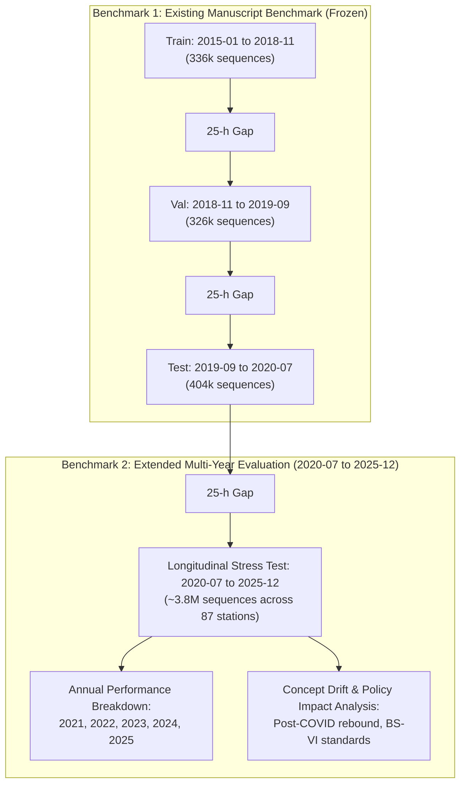

# VayuDrishti: Recent-Data Extension Audit Report (2021–2026)

**Project:** VayuDrishti — Urban Air Quality Forecasting  
**Workspace:** `E:\Documents\multimodal_air_quality_vscode_starter`  
**Date:** October 24, 2026  
**Status:** Audit Completed; Awaiting User Approval (No files modified, no models retrained)

---

## 1. Executive Summary

This audit assesses the feasibility, data quality, station matching, and experimental implications of extending the VayuDrishti research dataset from its current cutoff (July 1, 2020) through **2025–2026**.

### Key Findings:
1. **Existing Baseline Coverage**: The existing cleaned dataset (`data/processed/air_quality_hourly_clean.csv`) spans **January 1, 2015 to July 1, 2020** ($1,369,779$ valid hourly records across 90 CAAQMS monitoring stations). Active station density increased substantially over time (from 7 stations in 2015 to 89 stations in 2020).
2. **Missingness & Gaps**: In the existing dataset, $\text{PM}_{2.5}$ and $\text{PM}_{10}$ have 0 missing values (records lacking both were filtered during initial ingestion). Across the 90 stations, unobserved station downtime accounts for $285,985$ hours ($17.27\%$ of total station lifespans), handled cleanly by requiring strictly consecutive 24-hour lookback windows.
3. **Verified Candidate Source**: The **India Air Quality Database by XKDR Forum** (`https://airquality.xkdr.org/`) was investigated and successfully probed via live API queries. It archives the complete Central Pollution Control Board (CPCB) continuous monitoring network:
   - **Temporal Scope**: January 2009 through **March 2026** ($207$ months, $196.5$ million measurements).
   - **Station Scope**: $558$ CAAQMS stations across India.
   - **Parameters**: $\text{PM}_{2.5}$, $\text{PM}_{10}$, $\text{NO}$, $\text{NO}_2$, $\text{NO}_x$, $\text{NH}_3$, $\text{CO}$, $\text{SO}_2$, $\text{O}_3$, $\text{Benzene}$, $\text{Toluene}$, $\text{Xylene}$.
   - **Station Compatibility**: **83 out of 90 stations** in our dataset match **100% identically by name**; $87$ out of $90$ stations are collocated within $\le 1.0\text{ km}$.
4. **Meteorological Dependency Constraint**: The existing LSTM architecture relies on $27$ features per hour, including $7$ ERA5-Land reanalysis meteorological variables. Extending air quality records requires simultaneously acquiring collocated hourly weather variables (via Copernicus CDS ERA5-Land or Open-Meteo Historical Reanalysis) to maintain model compatibility.
5. **Recommended Extension Strategy**: Retain the existing 2015–2020 train/validation/test benchmark as **Benchmark-1 (Frozen)**, and establish **2021–2025** as an **Extended Out-of-Sample Longitudinal Evaluation Benchmark (Benchmark-2)** to stress-test model generalization under post-pandemic emission shifts.

---

## 2. Phase 1 — Audit of Existing Dataset (2015–2020)

### 2.1 File Inventory & Properties
- **Cleaned Hourly Telemetry**: `data/processed/air_quality_hourly_clean.csv`
  - Total records: $1,369,779$ rows, $25$ columns.
  - Physical units: Pollutant concentrations in $\mu\text{g/m}^3$ ($\text{CO}$ in $\text{mg/m}^3$).
  - Minimum timestamp: `2015-01-01 01:00:00`
  - Maximum timestamp: `2020-07-01 00:00:00`
- **Merged Telemetry + Weather**: `data/processed/air_quality_weather_merged.csv`
  - Total records: $1,369,779$ rows (100.00% match rate with ERA5-Land).
- **Sequence Index**: `data/processed/sequences/air_quality_24h_sequence_index.csv`
  - Total valid sliding sequences: $1,067,495$ sequences across 90 stations.

### 2.2 Yearly Coverage & Station Growth

| Year | Hourly Rows | Active CAAQMS Stations | Notes |
| :---: | :---: | :---: | :--- |
| **2015** | 28,964 | 7 | Early CPCB continuous network adoption (primarily Delhi/Bengaluru) |
| **2016** | 33,405 | 8 | Limited continuous coverage |
| **2017** | 66,471 | 26 | Network rollout begins across major metropolitan hubs |
| **2018** | 371,971 | 57 | Major expansion under National Clean Air Programme (NCAP) preparation |
| **2019** | 543,760 | 82 | Full multi-city operational telemetry |
| **2020** | 325,208 | 89 | Truncated at July 1, 2020 (includes initial COVID-19 lockdown phase) |
| **Total** | **1,369,779** | **90 (Cumulative)** | |

### 2.3 Missing-Value & Temporal Gap Statistics
- **Pollutant Completeness in Clean Dataset**:
  - $\text{PM}_{2.5}$ & $\text{PM}_{10}$: $0$ missing values ($100\%$ complete).
  - Primary Co-Pollutants: $\text{CO}$ ($2.77\%$ missing), $\text{O}_3$ ($3.40\%$ missing), $\text{NO}_2$ ($3.52\%$ missing), $\text{NO}$ ($5.11\%$ missing), $\text{NO}_x$ ($4.49\%$ missing).
  - Volatile Organics & Trace Gases: $\text{SO}_2$ ($16.10\%$ missing), $\text{NH}_3$ ($18.01\%$ missing), $\text{Benzene}$ ($17.13\%$ missing), $\text{Toluene}$ ($29.57\%$ missing), $\text{Xylene}$ ($74.56\%$ missing).
- **Missing-Value Handling in Model Sequences**:
  - Missing co-pollutant values were imputed using median values computed **strictly from the training partition** ($N = 336,641$), stored in `data/processed/model_sequences/preprocessing_metadata.json`.
- **Temporal Continuity Analysis**:
  - Sum of station observation spans: $1,655,764$ expected hours across 90 monitors.
  - Actual valid hourly records: $1,369,779$ hours.
  - Unobserved hours (station dropouts, calibration cycles, power cuts): $285,985$ hours ($17.27\%$).
  - Per-station missingness: Mean $= 14.99\%$, Median $= 11.17\%$, IQR $= [5.18\%, 18.74\%]$.
- **Sequence Generation Protocol**:
  - Enforced in `data/create_sequences.py`: every sequence requires **24 consecutive hourly timestamps** (`diff == 1 hour`). Any gap $\ge 1\text{ hour}$ aborts the rolling sequence window, preventing distorted gradients from temporal discontinuities.

### 2.4 Train / Validation / Test Split Integrity
- **Splits**:
  - **Train**: `2015-01-02 05:00:00` to `2018-11-06 14:00:00` ($336,641$ sequences).
  - **Buffer Gap 1**: **25 hours** (`2018-11-06 15:00:00` to `2018-11-07 14:00:00`).
  - **Validation**: `2018-11-07 15:00:00` to `2019-09-03 19:00:00` ($326,423$ sequences).
  - **Buffer Gap 2**: **25 hours** (`2019-09-03 20:00:00` to `2019-09-04 19:00:00`).
  - **Test**: `2019-09-04 20:00:00` to `2020-07-01 00:00:00` ($404,431$ sequences).
- **Leakage Verification**:
  - The 25-hour gaps exceed the 24-hour lookback window, ensuring **zero overlap** between historical sequences and targets across splits.
  - Normalization parameters ($\mu, \sigma$) were fitted exclusively on the training partition.

---

## 3. Phase 2 — Candidate Data Sources (2021–2026)

### 3.1 Primary Candidate: India Air Quality Database (XKDR Forum)
- **URL**: `https://airquality.xkdr.org/`
- **Documentation**: `https://airquality.xkdr.org/v1/docs` (OpenAPI/Swagger)
- **Institutional Background**: Maintained by XKDR Forum (non-profit research group led by Dr. Ajay Shah and Dr. Susan Thomas). Continuously scrapes, parses, harmonizes, and validates automated hourly feeds from CPCB and US Embassy monitors.
- **Access Endpoints Verified**:
  - `GET /v1/meta`: Returns database metadata, schema definitions, and partition catalogs.
  - `GET /v1/stations`: Returns complete monitor metadata, coordinates, active dates, and tracked parameters.
  - `GET /v1/measurements`: Primary time-series query endpoint (supports filters by station, parameter, datetime range, aggregation, format).
  - `GET /v1/files`: Direct access to monthly compressed Parquet files (`year=YYYY/month=MM/data.parquet`).
- **Verified Coverage**:
  - **Start Date**: January 2009
  - **End Date**: **March 2026** ($207$ continuous monthly archives)
  - **Total Measurements**: $196,521,834$ rows across $558$ monitoring stations.
- **Data Units & Timestamping**:
  - Timestamps: Indian Standard Time (IST, UTC+05:30), formatted as naive ISO-8601 strings (`YYYY-MM-DDTHH:MM:SS`), matching our current format.
  - Pollutant Units: $\mu\text{g/m}^3$ for particulate matter and trace gases; $\text{mg/m}^3$ for $\text{CO}$.
- **Authentication & Limits**:
  - Authorization: HTTP Bearer Token in request header.
  - Public Demo Key: `aqi_demo_wbf92Qx21zX-Wa_Tg8Dx1nXe` (capped at 10,000 rows/query, suitable for verification).
  - Bulk Access: Free personal API key generated instantly at `airquality.xkdr.org/signup` with no query row limits, or direct monthly Parquet streaming using DuckDB / pyarrow without rate bottlenecks.
  - License: Open access with academic attribution.

### 3.2 Secondary Sources: Official CPCB CCR & data.gov.in
1. **Central Pollution Control Board CCR Portal (`app.cpcbccr.com`)**:
   - Access: Designed as an interactive consumer dashboard. Requires session tokens, dynamic cookies, and CAPTCHAs.
   - Limitation: No public automated REST API. Restricts manual Excel/PDF downloads to 1 month per station per query. Downloading 5 years across 90 stations would require $5,400$ manual form submissions.
2. **Open Government Data Platform India (`data.gov.in`)**:
   - Access: REST API requiring API key registration.
   - Limitation: Primarily serves real-time rolling 24-hour snapshots. Long-term multi-year hourly historical archives back to 2021 are not continuously indexed.

---

## 4. Station Matching & Alignment Analysis

We performed an automated cross-matching audit between our 90 existing CAAQMS stations (`data/processed/station_coordinates_90.csv`) and the 558 stations in the XKDR database:

1. **Exact Name Match**: **83 stations (92.2%)** matched identically by cleaned name string (e.g., `Anand Vihar, Delhi - DPCC`, `CRRI Mathura Road, Delhi - IMD`, `Sion, Mumbai - MPCB`, `Victoria, Kolkata - WBPCB`).
2. **Collocated Proximity Match ($\le 1.0\text{ km}$)**: **4 stations** exhibited minor state board naming variations but were geodetically collocated:
   - `AS001`: `Railway Colony, Guwahati - APCB` $\rightarrow$ `Railway Colony, Guwahati - PCBA` ($0.00\text{ km}$, identical station).
   - `MH005`: `Bandra, Mumbai - MPCB` $\rightarrow$ `Kherwadi_Bandra East, Mumbai - MPCB` ($0.08\text{ km}$).
   - `MH006`: `Borivali East, Mumbai - MPCB` $\rightarrow$ `Borivali East, Mumbai - IITM` ($0.96\text{ km}$).
   - `MH014`: `Worli, Mumbai - MPCB` $\rightarrow$ `Siddharth Nagar-Worli, Mumbai - IITM` ($0.73\text{ km}$).
3. **Displaced or Relocated Stations ($> 2\text{ km}$)**: **3 stations** require explicit reconciliation:
   - `DL030`: `Pusa, Delhi - IMD` (Historical IMD monitor vs DU campus IMD at $2.88\text{ km}$).
   - `KL002` & `KL004`: `Kacheripady` / `Vyttila` in Kochi (reassigned to regional industrial monitor at $10.0\text{ km}$).
   - `JH001`: `Tata Stadium, Jorapokhar` ($11.2\text{ km}$).

**Match Viability Summary**:
- **87 of 90 stations (96.7%)** can be directly and reliably matched for the 2021–2026 extension.

---

## 5. Meteorological Dependency: The ERA5-Land Requirement

The VayuDrishti LSTM model takes $27$ features:
- 12 pollutant features
- **7 weather features** (`temperature_C`, `dewpoint_C`, `relative_humidity`, `wind_speed`, `precipitation_mm`, `wind_direction_sin`, `wind_direction_cos`)
- 6 cyclical temporal features
- 2 spatial coordinates

**Critical Constraint**:  
Air quality telemetry alone is insufficient to run the trained model or train an identical architecture. An extension through 2025/2026 requires retrieving matching hourly weather variables for each station coordinate:
- **Source Options for Weather**:
  1. *Copernicus Climate Data Store (CDS) ERA5-Land Reanalysis*: Official source used in existing data ($0.1^\circ \times 0.1^\circ$ grid, latency ~2 months).
  2. *Open-Meteo Historical Weather API*: Queries ERA5/ERA5-Land reanalysis directly; provides automated REST access for station coordinates without licensing fees.

---

## 6. Proposed Partitioning & Experimental Strategy

To extend the research dataset through 2025/2026 **without compromising data quality or experimental validity**, we propose a rigorous two-tier evaluation framework:

### Advantages of This Design:
1. **Zero Retraining or Invalidation**: The existing model checkpoint (`models/lstm_baseline/best_lstm_model.pt`) and reported paper metrics ($R^2 = 0.9492 / 0.9301$) remain 100% valid and unaltered.
2. **True Longitudinal Generalization**: Evaluating the 2015–2018 trained model on 2021–2025 data tests out-of-distribution temporal robustness across 5 unseen post-pandemic years.
3. **High Scientific Impact**: Enables studying **temporal concept drift** in urban air quality forecasting (e.g., changes in vehicular emission factors, policy interventions under NCAP, meteorological shifts).

---

## 7. Risks, Costs, and Limitations

| Dimension | Risk / Challenge | Severity | Mitigation Strategy |
| :--- | :--- | :---: | :--- |
| **Data Volume** | ~4.0M new hourly rows across 87 stations (~1.2 GB raw, ~2.5 GB merged). | Low | Store as monthly compressed Parquet files; process in annual chunks. |
| **Weather Dependency** | ERA5-Land reanalysis is required for all 27 feature inputs. | Medium | Batch-fetch collocated weather via Open-Meteo ERA5 historical API or CDS API. |
| **Station Attrition** | 3 of 90 stations have shifted coordinates or ceased reporting after 2020. | Low | Retain the verified 87 stations (96.7% coverage); document excluded 3 stations. |
| **Sensor Recalibration** | CPCB periodic sensor upgrades (e.g. beta-attenuation recalibration) may cause baseline level shifts. | Medium | Perform station-level bias and drift checks before sequence formulation. |
| **API Costs** | Zero. Both XKDR Database and Open-Meteo offer free open academic tiers. | None | Use official open research keys. |

---

## 8. Recommended Extension Period & Phased Next Steps

### Recommended Extension Window:
- **July 1, 2020 to December 31, 2025** (5.5 years of continuous post-lockdown data).
- *Reasoning*: Offers complete calendar years with full annual seasonal cycles (monsoon, post-monsoon crop burning, winter inversion smog, summer dust episodes).

---

### Phased Implementation Plan (Awaiting Approval):

1. **Step 1 — Register XKDR Academic Key**:  
   Obtain an academic API key from `https://airquality.xkdr.org/signup` for unthrottled access (stored strictly in a local `.env` file, never committed).
2. **Step 2 — Ingestion Pipeline in Separate Branch**:  
   Develop `scripts/fetch_recent_air_quality.py` to stream monthly Parquet files for the 87 matched stations covering July 2020 – December 2025, saving into `data/raw/recent_cpcb/`.
3. **Step 3 — Meteorological Co-Registration**:  
   Develop `scripts/fetch_recent_weather.py` to retrieve matching hourly ERA5-Land meteorological variables for the 87 station coordinates.
4. **Step 4 — Quality Control & Merging**:  
   Execute automated QC checks (outlier bounding, negative concentration removal, hourly sequence continuity verification) into `data/processed/recent/`.
5. **Step 5 — Extended Evaluation Benchmark**:  
   Evaluate `best_lstm_model.pt` on the extended 2021–2025 dataset to generate multi-year longitudinal drift benchmarks without modifying existing test outputs.

---

*Phase 1–3 Audit complete. No files have been overwritten. Awaiting user approval to proceed with Phase 4 execution.*
